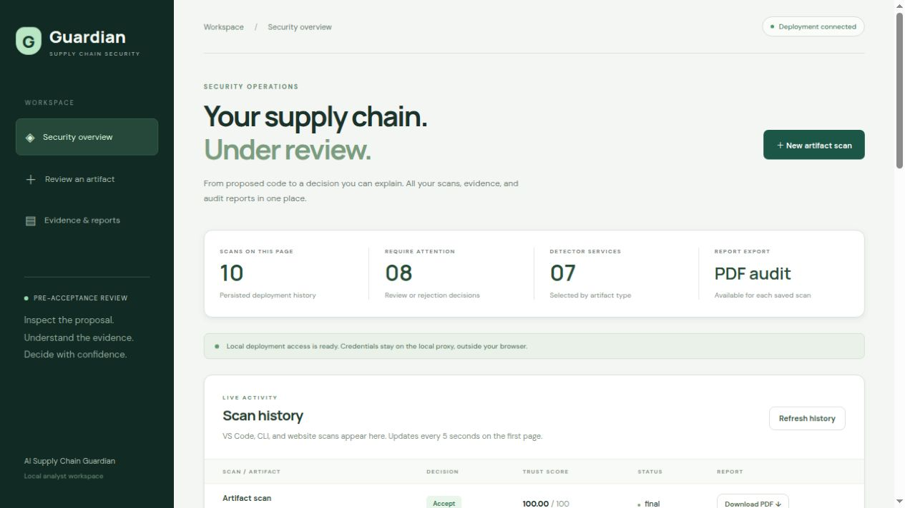

# AI Supply Chain Guardian

[](https://github.com/Cipher-Sheild/AI_Supply_Chain_Guardian-v2/actions/workflows/ci.yml)

**Inspect proposed code and configuration, understand the evidence, and decide before a supported coding-agent file tool writes it.**

Guardian combines seven detector services with a policy-controlled Trust Engine. It returns an **Accept / Review / Reject** recommendation, a 0–100 trust score, findings, coverage and explanations. Developers can use the website, CLI, HTTP API or VS Code extension; a separately configured Copilot **PreToolUse hook** enforces supported pre-write checks.



## What is included

| Component | Purpose |
| --- | --- |
| Code Security | Native Python AST / Tree-sitter checks for supported source languages |
| CipherGuard | Package existence, look-alike names, supported dependency advisories and risky lifecycle hooks |
| Secret Detection | Credential-pattern detection with contextual confidence and masked output |
| Docker Security | Dockerfile / Compose rules; separately requested supported OCI image inventories and OS advisories |
| Workflow Security | GitHub Actions / GitLab CI configuration risks |
| License Compliance | SPDX expressions, supplied license text and policy checks |
| Prompt Injection | Rules, MiniLM similarity, classifier and a configured judge for uncertain spans |
| Trust Engine | Capability routing, policy gates, weighted default, optional XGBoost / TreeSHAP, tenant-scoped SQL history and audit PDFs |

Only compatible detectors run for each artifact. A clean result means no supported finding in the **reported scope**, not proof that a whole application is secure. Incomplete checks cannot produce Accept. Redis supports caching/pending work; PostgreSQL is the Compose scan store and SQLite supports local use.

## Start with Docker Compose

Use Docker Engine/Desktop with Compose v2, Git, network access for build dependencies/models and sufficient memory for the complete stack. Initial model downloads/builds can take several minutes. Linux is the demonstrated host; native setup below assumes a Unix-like shell.

```bash
git clone https://github.com/Cipher-Sheild/AI_Supply_Chain_Guardian-v2.git
cd AI_Supply_Chain_Guardian-v2
cp .env.example .env
```

Edit the private `.env`: set **different random values** for `POSTGRES_PASSWORD`, `CALLBACK_TOKEN` and `GUARDIAN_API_KEY` (the client key must be at least 32 bytes). For example, generate each value separately with `openssl rand -hex 32`. Keep this file private.

Configure a prompt judge. The default is an externally running Ollama service; the stack does not install Ollama. Point `OLLAMA_HOST` at that service and set an available `OLLAMA_MODEL`. Alternatively set `LLM_PROVIDER=groq`, `GROQ_MODEL` and a private `GROQ_API_KEY`, or another supported provider documented in the [runtime configuration](docs/RUNTIME_CONFIGURATION.md). A missing/unavailable judge can leave uncertain artifacts at Review; do not turn missing evidence into a pass.

```bash
docker compose up --build -d
docker compose ps
curl --fail http://127.0.0.1:8000/health
```

- Website: **http://127.0.0.1:3000**
- API / interactive documentation: **http://127.0.0.1:8000/docs**
- Enter the deployment client key in the dashboard access control when requested. It is separate from callback credentials. The optional development proxy described below keeps a local client key outside the browser.
- The normal scanner remains **weighted**. Start with a small artifact, wait for `final`, then reopen the saved scan or download its audit PDF.
- If ports are occupied, change `TRUST_ENGINE_PORT` and `DASHBOARD_PORT` in `.env` and use those URLs consistently.
- `docker compose down` stops the stack; retained volumes preserve data. Do not remove volumes unless you intend to delete the saved deployment history.

The complete Compose startup includes database migration/seed dependencies and health checks. Public TLS, backup/restore and concurrent-load readiness require deployment-specific work.

## Native local development

Use **Python 3.12** and **Node.js 22.12+ / npm**. The setup script creates an isolated environment, installs pinned service/training dependencies, downloads pinned model assets and builds the extension. Default Docker/license engines do not require Hadolint, Trivy, Semgrep or ScanCode executables; those are optional compatibility engines.

```bash
python3.12 scripts/setup_local.py
# With Ollama installed and running, create the bounded judge alias:
ollama create guardian-judge -f services/prompt_injection/models/OllamaModelfile
.data/venv/bin/python scripts/run_local.py --python "$PWD/.data/venv/bin/python" --dashboard
```

Default native API: **http://127.0.0.1:18108**; website: **http://127.0.0.1:3000**. The launcher isolates storage under `.data/`, binds to loopback and stops owned services on Ctrl-C. To run with a different provider use `--judge-provider groq` (and the provider's private environment settings); use `--state-dir` for isolated stacks. A private `GUARDIAN_API_KEY` environment value enables client authentication; use the same value in your clients. Do not expose an unauthenticated local configuration publicly.

For an authenticated development website, point the Vite proxy at the actual API and a mode-600 client file outside the repository:

```bash
TRUST_ENGINE_URL=http://127.0.0.1:18108 \
GUARDIAN_DASHBOARD_CLIENT_CONFIG="$HOME/.config/guardian/client.env" \
npm run dev --prefix frontend -- --host 127.0.0.1 --port 3000 --strictPort
```

That file contains `GUARDIAN_API_KEY=...`. Do not launch a second website on port 3000 if the native launcher's `--dashboard` is already using it. The [user manual](docs/USER_MANUAL.md) covers other deployment options.

## CLI

Create a private mode-600 client file outside the checkout, then scan a file or directory:

```bash
python3 scripts/guardian_cli.py path/to/app.py \
  --url http://127.0.0.1:8000 \
  --deployment-config "$HOME/.config/guardian/client.env"
```

Exit codes: **0 Accept**, **2 Review / below threshold**, **3 Reject**, **4 error / incomplete result**. Review/Reject are expected gate outcomes, not necessarily a broken scanner. Directory scans cover supported source/configuration files; they do not execute the program or establish a complete dependency/build graph.

## VS Code and Copilot pre-write checks

```bash
npm ci --prefix integrations/vscode
npm run build --prefix integrations/vscode
npm run package --prefix integrations/vscode
code --install-extension integrations/vscode/guardian.vsix
```

Set `guardian.serverUrl` to your API. Run **Guardian: Import Client Key from Deployment Configuration** (or **Guardian: Set API Key**), then **Guardian: Scan Active Artifact**. Optional scan-on-save reports findings after a save; it is distinct from pre-write enforcement.

For supported Copilot tools, prepare a separate trusted workspace:

```bash
python3 scripts/prepare_video_demo.py \
  --workspace "$HOME/GuardianVideoDemo" \
  --url http://127.0.0.1:8000 \
  --deployment-config "$HOME/.config/guardian/client.env"
code "$HOME/GuardianVideoDemo"
```

Inside VS Code enable `chat.useHooks`, run **Chat: Configure Hooks**, and use a **Local Copilot Agent** session. Verify a real hook execution in **Output → GitHub Copilot Chat Hooks**. The adapter reconstructs supported create/edit/restricted patch proposals in memory and requires a final Accept before allowing the file tool. Review, Reject, service failure, invalid results and unsupported write tools deny it.

Inline Tab completion, manual edits, arbitrary tools and other harnesses are outside this enforcement boundary. Normal tool approvals should remain enabled. See the [preacceptance guide](integrations/vscode/PREACCEPTANCE.md), [demo prompts](demo/prompts) and [filming script](docs/demo/Guardian%20Demo%20Script.pdf). The setup script never creates the demonstration source files; Copilot proposes them during the recording.

## ML, SHAP and measured results

The optional model is a **98-feature XGBoost trust-score regressor**, not the prompt-injection classifier. Exact TreeSHAP explains the numerical model prediction before policy gates. A hard override bypasses model inference; an unusable model has an explicit weighted fallback with a Review floor. The candidate is **not promoted** to the default.

| Evaluation cohort | Weighted verdict agreement | ML verdict agreement | Interpretation |
| --- | ---: | ---: | --- |
| 90 previously inspected synthetic development cases | 77.78% | **83.33% (v4)** | Development retest; v4 MAE 13.31; not independent validation |
| 18 AI-labelled first-use cases (historical v3) | 66.67% | 61.11% | AI labels; three false accepts for each before targeted fixes |
| 10 previously inspected upstream files, final identical-response replay | 40% | 40% (v4) | Project-team review; eight Accept / two Review labels; no Reject cases |

The v4 candidate adds 127 training-only synthetic clean-pattern anchors; the ten upstream review labels were not used for training. The final upstream replay follows a canonical MIT-body recognition repair. Five of eight reviewer-Accept files still receive Non-Accept decisions. This small, previously inspected cohort cannot establish malicious-input recall or independent generalisation. **There is no single validated real-world accuracy number or independently validated production-readiness claim.** The earlier public prompt evaluation retained ten missed attacks, nine false positives and two unknown responses.

The final recorded Local Copilot demonstration on **19 October 2026** allowed six safe proposals and denied all six unsafe proposals before file creation. Weighted scoring returned four Reject and two Review decisions on unsafe proposals; v4 with safety gates returned three Reject and three Review. **Weighted scoring controlled writes; v4 was advisory.** These are **12/12 expected allow/block outcomes on selected fixtures**, not general detection accuracy or exact three-class agreement. Review also denies a supported write. Automated hook simulations in the candidate evidence are separate from actual Copilot execution evidence.

Historical component evidence totals **729 distinct Python cases passed across separately recorded suites**, including one separately completed PostgreSQL integration case, plus **nine browser cases counted separately**. This is not one unified 729-pass command and does not describe a fresh run of the current checkout. Test passes do not measure detection accuracy.

See the [v4 candidate evidence](evaluation/trust_model/v4-clean-patterns/README.md), [final readiness audit](evaluation/trust_model/readiness-audit-20261019/README.md), [historical results report](docs/reports/Results%20of%20the%20entire%20project.pdf), [ML implementation](docs/ML_AND_SHAP_IMPLEMENTATION.md), [v3 development evidence](evaluation/trust_model/v3/README.md) and [first-use pilot](evaluation/trust_model/final-ai-pilot-20261018/README.md). Model/fixture hashes, scope, labels and provenance are retained with each cohort. Some historical response inputs remain local; consult each reproduction guide before attempting a retrain.

## Tests and reproducibility

After native dependency setup:

```bash
.data/venv/bin/python scripts/verify_test_suites.py --output .data/latest-test-results.json
.data/venv/bin/python scripts/sync_contracts.py --check
.data/venv/bin/python scripts/sync_runtime.py --check
npm run build --prefix frontend
npm test --prefix integrations/vscode
```

The PostgreSQL integration case requires a **separate migrated test database** via `TEST_DATABASE_URL`; never use your demonstration/history database for tests. Browser checks require Playwright's Chromium installation and the configured backend/fixture mode. GitHub Actions runs isolated service checks, interface builds, model safety/training checks and a dedicated PostgreSQL job. External package/model feeds and live demos have separate operational requirements.

## Development status and next work

Weighted enforcement remains the default; the v4 model is an evaluation candidate. The local comparison view is available through **Guardian: Show Live Comparison** in a trusted VS Code workspace. Its log records inspection decisions, not proof of subsequent file creation. Optional dashboard comparison data requires the private `GUARDIAN_COMPARISON_LOG` setting in the local Vite development server; these development routes are not a production API contract.

Planned work includes broader language/ecosystem support, additional security and compliance checks, evaluation on larger independently reviewed real-world datasets, and improved AI analysis, calibration and explainability. Production promotion additionally requires deployment security, recovery and load validation. See the readiness audit for the concrete remaining work.

## Documentation and reports

- [Complete project documentation](docs/FINAL_PROJECT_DOCUMENTATION.md), [user manual](docs/USER_MANUAL.md), [runtime configuration](docs/RUNTIME_CONFIGURATION.md)
- [Architecture](docs/SDD.md), [requirements](docs/SRS.md), [shared contract](docs/CONTRACT_V1.md), [test plan](docs/TEST_PLAN.md)
- [ML and SHAP implementation](docs/ML_AND_SHAP_IMPLEMENTATION.md), [labeling guide](docs/DATA_LABELING_GUIDE.md)
- [Final black book](docs/reports/BlackBook%20Final.docx), [project results](docs/reports/Results%20of%20the%20entire%20project.pdf), [demo script](docs/demo/Guardian%20Demo%20Script.pdf)

The complete project documentation is a dated engineering snapshot, not the current development setup authority. Use this README and the runtime configuration for current setup. Dated documents and earlier evaluation snapshots may describe previous revisions. The cohort-specific evidence and qualifications above supersede older headline counts and accuracy claims.

## Scope and attribution

Guardian is a research prototype. Detection is bounded by supported rules, file types, external sources and requested scope. Container configuration-only scans do not inspect image contents/CVEs; supported resolved-image checks do not cover every platform or language package. Suggested fixes are not build-verified. Public login/account management and universal assistant interception are not implemented.

Third-party libraries, model checkpoints and retained upstream examples keep their own licenses and notices. Source provenance and matching notices accompany the real-artifact evaluation. No project-wide redistribution license has been declared in this repository.

**Team:** Abdulelah Alolofi (project lead), Ahmed Mohammed and Ali Altam. Team contribution details are recorded in the black book.
