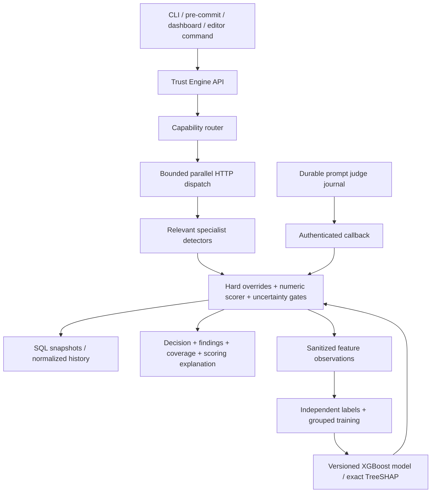

# AI Supply Chain Guardian — complete local project documentation

Prepared 12 October 2026. This is the current engineering description. Historical project references and Checkpoint reports are retained separately; their older completion statements do not override this document. Measured results are in `final-validation-clean/test-results.json`, `final-validation/host-smoke.json` and `../evaluation/trust_model/results.json` once training completes. No GitHub push is performed in this run.

## 1. Purpose and delivered scope

Guardian reviews software artifacts before developer acceptance or commit. It combines seven specialist detectors through a Trust Engine, produces a numerical score from 0 to 100, and recommends Accept, Review or Reject with evidence and coverage. It supports explicit web/CLI/editor review and a pre-commit gate. It does not automatically intercept every AI assistant's Accept button. A command or hook must invoke it.

The proposed contribution is coordinated artifact-level assessment and explainable fusion. Wrapping established tools is not itself a new detector, and adding XGBoost does not establish research novelty. This implementation supplies deterministic policy and an optional trained synthetic-pilot scorer for comparison; independent generalization remains to be established.

## 2. Architecture and responsibility boundaries



Eight FastAPI services run in separate processes/containers. LangGraph routes, calls detectors and fuses; parallelism is bounded asyncio dispatch. These are specialist scanner services, not autonomous reasoning agents that negotiate with one another. Only the Trust Engine owns scan-history SQL writes. Redis is a detector cache; it is not the production authority for final scan history. Prompt work has a persistent SQLite job/outbox journal.

Compose defines PostgreSQL, Redis, migration/seed dependencies, internal detector ports, a public Trust Engine and dashboard proxy. Native setup/launch scripts provide a local alternative. Container deployment and local process execution are different verification scopes.

## 3. Every detector

| Service | What it does | Actual mechanism | Scope and limits |
|---|---|---|---|
| CipherGuard | Detect nonexistent and suspicious dependencies | PyPI/npm metadata, normalized name similarity against reference corpora, age/maintainer/download heuristics; bounded HTTP/cache | requirements files and package.json; no complete installed dependency graph, crates.io or code-import extraction. Registry failures remain uncertainty. Historical package benchmark numbers are not newly reproduced in this run. |
| Code Security | Detect insecure source patterns | 37 bundled Semgrep rules across Python, JS/TS, PHP and Java; pinned native OSS engine with severity/remediation mapping | Go has no security rule pack and remains partial. Incomplete parsing reduces coverage. No whole-program guarantee or comprehensive OWASP coverage is implied. |
| Secret Detection | Find hardcoded credential patterns | Vendor signatures, assignment/connection-string context, entropy and suppression | Native scanner, not a Gitleaks wrapper. Masked previews; fabricated corpus credentials. Unknown vendor formats and broad real-world calibration remain limits. |
| Docker Security | Review Dockerfiles and Compose | Custom rules, Hadolint, Trivy config, registry reference checks; optional image scan and hardening suggestions | Suggestions are not build-verified repairs. External registry/digest verification and CVE-image scenarios need separate proof. |
| Workflow / CI-CD | Review GitHub Actions supply-chain risks | YAML structure, action SHA refs, permissions/triggers and remote shell patterns | GitLab remains partial. Does not prove all supply-chain risks are detectable. |
| License Compliance | Identify and review dependency license policy | Registry metadata, ScanCode text fallback, SPDX expression tree, configured policy and capped one-level transitive checks | Unknowns and ordinary conflicts impose Review. Explicit organization denylist supplies Reject. No full SBOM, source-archive audit or installed version-range resolution. |
| Prompt Injection | Find instructions targeting downstream AI tools | Lexical/obfuscation checks, pinned MiniLM embeddings, optional asynchronous Ollama/OpenAI judge | Code and Markdown scope. Missing embedding/judge capacity is uncertainty. Detection can miss evasions; semantic similarity is not a security proof. |

The existing designs are preserved where regressions and actual executions match their declared scope. Final-run changes specifically fix Semgrep startup/process handling/partial parsing, reject unexecuted claims of clean coverage, and ignore records explicitly marked unselected. Native Semgrep is the same pinned engine/rules, not a replacement heuristic pretending to be Semgrep.

## 4. Routing

Routing is deterministic: validated explicit type, filename/path capability rules, narrow content sniffing, then unknown fallback. Canonical type/ecosystem/filename is forwarded to detectors. Each batch file is routed independently.

| Artifact | Selected detectors |
|---|---|
| Code | Code Security, Secret Detection, Prompt Injection |
| Dependency manifest | CipherGuard, License Compliance, Secret Detection |
| Dockerfile or Compose | Docker Security, Secret Detection |
| GitHub workflow | Workflow Security, Secret Detection |
| Markdown | Prompt Injection, Secret Detection |
| Unknown text | Secret Detection; overall partial coverage |
| Excluded lockfiles / binary / unsupported work | Coverage none or partial; never confident Accept |

The canonical matrix is `contracts/capabilities.json` and generated service copies; verify with `scripts/sync_contracts.py --check`. The source matrix distinguishes unsupported specialist formats, including Go/GitLab/pyproject/Pipfile. Agent guards remain behind the router as a direct-call safety net.

## 5. Shared contract and deterministic Trust Engine

AgentResult contains a stable agent identity, pass/warn/fail/error/stub/pending status, typed findings, coverage, unresolved state and policy floor. Findings retain category, severity, confidence, location, reason/remediation and detector-specific details. Confidence is finite in [0,1]. Pending requires callback identity. Missing results and transport errors cannot be silently counted as successful checks.

Fusion applies hard rejection overrides, then weighted or learned numerical scoring, then authoritative coverage/status/license/severity gates. Default score bands are Accept >=80, Review >=50 and Reject below 50, subject to stricter gates. Ordinary license conflict is a Review minimum; combined numerical risk can still Reject. Only explicit organization denial supplies a license rejection override.

The weighted baseline is `100 - total severity-weighted confidence`, clamped to [0,100]. Clean observations are evidence, not fabricated risky findings. Explicitly unselected records cannot change scores or overrides. Expected but unexecuted checks impose Review. Numerical scoring does not establish that an artifact is safe.

## 6. Persistence and asynchronous lifecycle

All initial scans persist, including already-final ones. Scan snapshots retain input/routing/results, per-file outcomes, scoring metadata, callback state and timestamps. Normalized SQL rows retain scans, artifacts, agent executions, findings and fractional scores. GET/history returns recorded outcomes rather than silently rescoring historical artifacts with a newer model.

Callbacks require constant-time token authentication, matching identity and valid typed bodies. Database row locks serialize updates across workers. Duplicate callbacks are idempotent. Overdue pending results become final error/uncertainty with Review or stricter recommendation; late clean callbacks cannot replace a timeout.

Prompt jobs/results are journaled before/after judging, leased atomically, replayed after restart and retried with bounded exponential backoff. Callback tokens are not stored in the journal. Submitted artifact content is stored in SQL/journal: protect these volumes. Local SQLite/journal files use restrictive permissions. Data retention/backups remain operator responsibilities.

## 7. ML, labels and training

See `../evaluation/trust_model/README.md` for the complete corpus rubric and reproduction commands. The pilot contains 360 constructed artifacts, 120 per label, with 180/90/90 train/validation/test rows and disjoint construction-family groups. Labels/rationales are assigned before running detectors. SHA-256 checks bind collected responses to submitted files. Python/YAML construction syntax is checked.

This is project-authored synthetic data, not independently reviewed human ground truth or an external benchmark. Naming variants are related samples. A grouped split reduces obvious leakage but does not make these templates independent of their author. Labels use ordinal trust anchors 100/65/0; these are not probabilities.

Training uses a versioned 98-feature risk transform: severity counts, maximum finding confidence, hard blocks, bounded detector scores, fixed category-group counts and explicit selected unavailability for each detector. Unselected risk measurements remain NaN; missing execution is not clean zero. Outcome, existing recommendation, IDs, content and incidental timing are excluded. Relevant detectors run, rather than forcing all seven onto every artifact.

A CPU XGBoost regressor is trained with non-increasing trust constraints on risk features. Validation chooses candidate depth; held-out test is not used for selection. Evaluation compares policy-adjusted predictions against weighted scoring and reports false accepts, confusion matrices, per-type accuracy, MAE and safety-gated agent ablations. Synthetic-trained numerical predictions remain subordinate to deterministic policy.

The model is native JSON plus a feature schema/version, training scope and checksum metadata. Loading/inference failure returns a visible weighted fallback. `TRUST_SCORER=weighted` remains the default; `TRUST_SCORER=ml` enables the candidate for local evaluation. Replace/restart with a new versioned artifact after independently reviewed validation; do not silently promote a worse model.

## 8. SHAP explanations

Native XGBoost exact TreeSHAP supplies baseline and feature contributions. Training checks agreement with the SHAP library and verifies additivity. Contributions are grouped by detector in the API/dashboard/PDF. They sum to the raw model prediction before clamping/rounding/policy gates. A hard override bypasses the model and is shown as an override, without invented SHAP values.

These values explain what the model used; they are not causal proof or a rationale for removing an override. Original detector evidence and deterministic risk breakdown remain separate. Scoring metadata and per-file outcomes persist so historical model explanations do not change after retraining.

## 9. Interfaces and API

- `GET /health`: dependency/capability readiness, 503 when degraded; not a security verdict.
- `POST /analyze`: single artifact; `POST /analyze/batch`: typed files and per-file outcomes.
- `POST /callback/{callback_id}`: internal authenticated resolution.
- `GET /scans/{request_id}`: recorded final/provisional scan; `GET /scans`: paginated history.
- `GET /scans/{request_id}/audit.pdf`: evidence/coverage/scoring report, including model contributions when present.
- CLI: final Accept plus threshold exits 0; Review/threshold exits 2; Reject exits 3; transport/invalid/provisional failure exits 4.
- Pre-commit: invokes CLI on passed files. Server must be available; no acceptance on service failure.
- Dashboard: same-origin proxy, upload/text entry, polling, evidence, per-file results, history and PDF export.
- VS Code: explicit **Guardian: Scan Active Artifact** command submits unsaved buffer, polls, shows diagnostics and invalidates results after edits. Build/package checks do not establish editor interaction. It does not intercept every AI assistant acceptance action.

Bounds: 50 files, 256 KiB/file, 1 MiB aggregate batch, 2 MiB POST body; bounded scanner/outgoing workers; global dispatch deadline includes queue time. Timeout and admission rejection are honest incomplete scans. Bounds do not constitute a p95 latency guarantee.

## 10. Run locally

```bash
python3 scripts/setup_local.py
# Hadolint 2.15.1 and Trivy 0.74.0 must be available on PATH.
# Start local Ollama and obtain the model you select; this host has llama3.2:latest and a bounded guardian-judge alias.
.data/venv/bin/python scripts/run_local.py --python "$PWD/.data/venv/bin/python" --dashboard --scorer weighted
# Optional candidate evaluation:
.data/venv/bin/python scripts/run_local.py --python "$PWD/.data/venv/bin/python" --dashboard --scorer ml
```

The native launcher defaults to SQLite and tolerates Redis cache loss. Its Trust Engine URL is port 18108, dashboard 3000. Use `--database-url` for an explicitly migrated PostgreSQL database and `--redis-url` for Redis. Do not point verification scripts at an important database. The native launcher creates a private `.data` directory and never prints callback credentials. Ctrl-C stops its owned child processes.

For Compose, copy `.env.example` to a private `.env`, set callback/DB/judge configuration, download the pinned embedding snapshot if needed, then `docker compose up --build -d`. Migration and seed dependencies are configured. This run has no Docker daemon permission, so actual image startup/hardening remains unverified. No administrator group modification is performed automatically.

## 11. Verification and results

Agent-by-agent responsibilities, evidence and changes are recorded in AGENT_REVIEW.md; the complete local source/artifact inventory is in final-validation/FILE_INVENTORY.md.

Read `final-validation/VERIFICATION.md` for final counts and reproducible commands. Local tests, native full-stack HTTP checks, PostgreSQL row-lock checks, build checks and synthetic corpus metrics answer different questions. Do not substitute unit tests for detector accuracy or one-off smoke timings for p50/p95 under load. Prior CipherGuard benchmark claims are historical and need their original evidence before reuse in a paper.

## 12. Security and remaining limits

This is a local/team project. Callback authentication and resource/work limits exist; public user authentication, tenant isolation, TLS termination and automatic retention are not implemented. Do not expose it as a public multi-user service without those controls. Docker hardening suggestions remain unverified builds. Go/GitLab/full dependency graph support are explicitly partial/out of scope. Actual browser/editor interaction requires manual validation. No LSP or universal AI-provider interception is delivered.

The trained synthetic pilot and full inference/SHAP path are implementation deliverables. Independently reviewed data, externally authored held-out attacks, calibrated real-world reliability and publication-ready novelty/accuracy claims still require evidence. A numerical model cannot compensate for missing detector signals.

## 13. Repository ownership and delivery

Changes remain in the CLEAN directory and are committed locally after verification. No old repository push/merge is authorized. Downloaded embedding weights/runtime environments are ignored by Git and reproducibly obtained by scripts. The small learned model and its metadata are versioned. Private `.env`, SQL/journal content, caches and environment credentials must not enter a new repository. Choose your repository owner, public license and extension publisher before public distribution.
