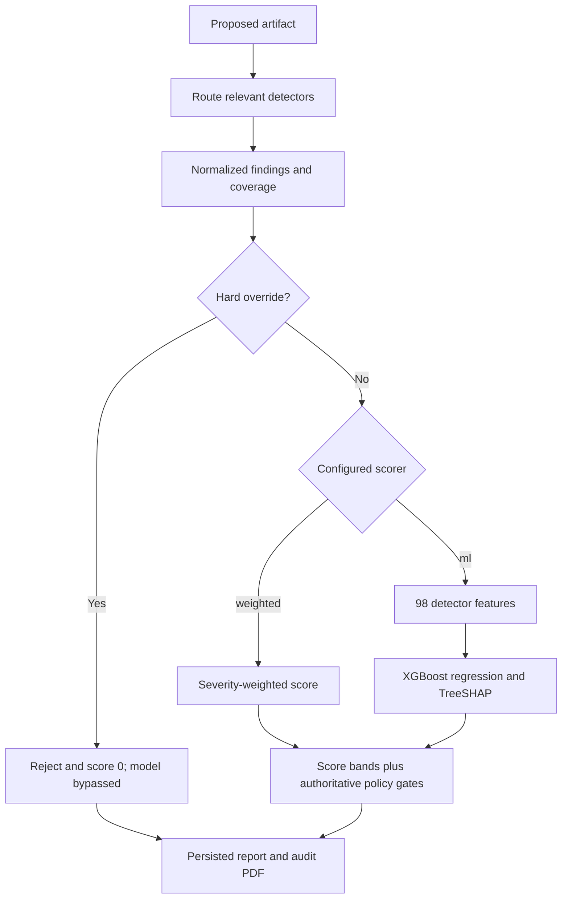

# ML and SHAP in AI Supply Chain Guardian

**Implementation explanation and evaluation record — 18 October 2026**

This document explains the actual repository implementation: how the deterministic Trust Engine was extended with an optional learned scorer, how SHAP was integrated, how training data were constructed, what the 66.67% result means, and what remains unverified. “SHAP” is the correct name; “shape” in our discussion refers to SHAP explainability.

The implementation sequence below describes the architectural dependencies visible in the code. It is not a reconstructed commit-by-commit development timeline.

> **Update:** Section 17 records the newer, scope-explicit development retest. The earlier 66.67% result remains valid for its historical snapshot; it is not silently replaced by a differently scoped result.

## 1. The main answer

The Trust Engine was **extended, not replaced**. Routing, coverage checks, pending/error handling, hard rejection rules, and final decision policy remain explicit code. A configurable scoring interface allows either a weighted formula or an XGBoost regression model to supply the numerical trust score. Exact TreeSHAP explains the model's numerical prediction; it does not decide whether to allow a file.

The default configuration remains weighted. The research ML demonstration used a separate configuration and a specifically identified candidate model. The historical native-v2 benchmark is **60 correct final decisions out of 90 test artifacts = 66.67%** for both the weighted and ML pipelines. ML reduced numerical score error, but it did not increase overall decision accuracy or eliminate the five false accepts.

Synthetic data made a controlled, reproducible pilot possible. It does not establish real-world accuracy. The generator and labels were authored within the project, without independent human review.

## 2. What the deterministic Trust Engine did first

### 2.1 Input and orchestration

An artifact enters through the website, CLI, or a supported editor tool gate. Routing selects relevant detectors; all seven detectors do not necessarily run on every file. Detector responses contain findings, severity, confidence, execution status, coverage and, where relevant, a decision floor or hard-block flag.

The seven detector groups are CipherGuard, Code Security, Docker Security, License Compliance, Prompt Injection, Secret Detection, and Workflow/CI-CD Security.

The fusion layer consumes the normalized state, rather than asking an LLM to invent a score.

### 2.2 Weighted numerical formula

The original scorer subtracts accumulated finding risk from 100:

```text
finding_risk = severity_weight × finding_confidence
aggregate_risk = sum(finding_risk for relevant findings)
weighted_trust = round(clamp(100 − aggregate_risk, 0, 100), 2)
```

| Severity | Weight |
|---|---:|
| Critical | 40 |
| High | 25 |
| Medium | 10 |
| Low | 3 |
| Info | 0 |

For example, a high finding with confidence 0.85 contributes 25 × 0.85 = 21.25 risk points. With no other risk and no override, the weighted score is 78.75.

These weights are explicit policy choices, not learned coefficients or calibrated attack probabilities.

### 2.3 Policy has authority over the score

The score bands are:

| Numerical score | Initial band |
|---|---|
| At least 80 | Accept |
| At least 50 and below 80 | Review |
| Below 50 | Reject |

The implementation then preserves stronger policy requirements. Partial/no coverage, missing expected results, pending/error states, unresolved observations, inconsistent detector status and other uncertainty can require at least Review. A high/critical finding cannot end at Accept merely because the score remains above 80.

Hard overrides force Reject and report score 0. Examples in the code include an agent requiring rejection, a finding with `hard_block`, CipherGuard finding score at least 90, critical secret findings, sufficiently confident high secret findings, critical prompt injection, and critical code-security findings.

**A score of 100 with Review is possible:** numerical findings may contribute no risk while a detector failed to provide complete evidence. Review blocks a write in the configured editor gate, just as Reject does.

## 3. How ML was added after that baseline

The implementation separates the numerical scorer from the policy layer.

1. `Scorer` defines the `score(state, total_risk)` interface.
2. `WeightedSumScorer` implements the original formula.
3. `ConfiguredScorer` reads the requested mode, loads/caches the candidate model when needed, and records scoring metadata.
4. `Predictor` converts detector state into the same fixed vector used during training, runs XGBoost and computes TreeSHAP.
5. `fuse()` uses the chosen numerical score but retains its independent uncertainty, severity and override rules.
6. `scoring_details()` prepares the explanation and separates numerical contributions from policy effects.
7. Scan persistence, API responses, the dashboard and audit PDF carry that scoring metadata.



Coverage and status requirements are accumulated before numerical scoring; the diagram shows their final authority at the decision stage.

### Why add ML?

A fixed sum treats each finding contribution according to the same hand-set formula. A learned tree model can fit interactions and different combinations of detector observations against separately assigned target scores. This is the design motivation, not proof that it improves all outcomes. The pilot supports a reduction in score MAE only; it does not support an overall accuracy-improvement claim.

### Is the system still deterministic?

A trained model is not automatically random during inference. With the same loaded model, feature vector and policy state, this CPU inference path produces a reproducible prediction. Training uses a fixed seed and fixed parameters. However, fresh end-to-end scans can change when registries, advisory feeds, image inventories, detector versions or asynchronous evidence change. Reproducible model inference and unchanging external scan results are different properties.

## 4. What the ML model actually receives

The model does **not** read the proposed Python, YAML, Markdown or package file directly. The detectors inspect the artifact; the scorer receives structured numerical summaries of their observations.

`app/features.py` constructs a versioned observation event. `app/ml/vector.py` turns that event into a fixed feature order.

There are **7 detector groups × 14 measurements = 98 features**, with vector schema `guardian-risk-v2`.

| Per-detector measurement | Meaning |
|---|---|
| `critical`, `high`, `medium`, `low`, `info` | Counts of findings at each severity |
| `max_confidence` | Highest finding confidence |
| `hard_blocks` | Count of hard-block findings |
| `score_max` | Maximum allowed numeric risk/evidence/finding score |
| `unavailable` | Count of selected observations that did not run, remain pending/error/stub/unresolved, or lack full coverage |
| `execution_risk` | Count in fixed execution-related categories |
| `data_access_risk` | Count in fixed data-access categories |
| `credential_risk` | Count in fixed credential categories |
| `privilege_risk` | Count in fixed privilege categories |
| `policy_risk` | Count in fixed policy categories |

Across files, the vector sums relevant counts and takes the defined maxima. The pilot training reconstruction currently requires one artifact per request; a model's ability to score a multi-file state does not establish benchmark accuracy for multi-file batches.

### Missingness is not a clean scan

For an unobserved detector group, risk measurements are `NaN`; its `unavailable` slot is zero. For selected observations with incomplete execution, the unavailable count is explicit. Routing and expected-result checks separately protect the policy outcome. This prevents treating every absent detector as a successfully executed clean detector.

### Leakage and privacy boundaries

The predictor vector excludes final trust score, recommendation, labels, target score, sample identity, request ID, raw artifact content, package names, raw snippets, timestamps and latency. The training exporter removes the outcome from exported observations and clears elapsed time. Some general observation events can still contain operational identifiers or outcome metadata; those are **not vector inputs**. Calling the entire event identifier-free would be inaccurate.

Excluding labels from inputs prevents direct target leakage. It does not remove author bias, label ambiguity, related-template similarity, or information lost when findings are summarized.

## 5. The dataset: what “synthetic” means here

### Construction

`scripts/build_trust_corpus.py` creates controlled examples and assigns labels **before scanning**. The manifest includes sample ID, artifact path/type, group, split, rationale, target, SHA-256 and explicit flags stating that independent review was not performed.

The six artifact types are Python code, GitHub Actions workflows, Compose files, Dockerfiles, dependency manifests and Markdown. Each type has four construction families. Each family contains three labels and five variants per label:

```text
6 types × 4 families × 3 labels × 5 variants = 360 artifacts
```

The resulting 24 families are divided into:

| Split | Artifacts | Construction families | Purpose |
|---|---:|---:|---|
| Training | 180 | 12 | Fit model trees |
| Validation | 90 | 6 | Select among candidate depths |
| Test | 90 | 6 | Report held-out outcomes |

The test split contains 30 Accept, 30 Review and 30 Reject labels. Each artifact type contributes 15 test cases. Variants belonging to the same family stay together; exact group IDs do not cross splits. There is only one test family per artifact type, so family and artifact type are confounded in the test set.

### Label rubric and targets

| Construction label | Score target | Intended interpretation |
|---|---:|---|
| Accept | 100 | No intentionally planted defect within the stated artifact scope |
| Review | 65 | Ambiguous, policy-sensitive, unresolved or unsafe choice needing assessment |
| Reject | 0 | Intentionally planted direct injection/execution, credential exposure, privileged configuration or fictional dependency |

These are engineering anchors. A target of 65 does not mean “65% safe.” A synthetic Accept label means no defect was deliberately planted under that rubric, not that a real deployment is vulnerability-free.

### Why synthetic data were used

The implemented corpus supplies controlled labels and reproducible examples spanning the project's mixed artifact types and final three-way policy. It can exercise rare unsafe cases without requiring real leaked credentials or executing malicious workloads. It also makes artifact hashes and related-variant grouping inspectable.

The repository does not establish a provenance-reviewed, independently labelled external dataset matching this exact combined task. Synthetic construction was a practical pilot method, not a claim that external datasets do not exist.

**Synthetic artifacts and fabricated results are different things:** these are constructed inputs sent to the detectors, whose recorded responses become training observations. The later verification replayed historical detector responses; it did not freshly rescan all 360 artifacts.

### Limits

The implementation agent authored both construction and labels. Related templates remain similar even with disjoint groups. Variants often differ only in names or small values. Labels can conflict with expanded scan scope: a non-root Compose template labelled Accept can reference an image with reported vulnerabilities. Tags, registry existence and vulnerability feeds change. Constructed distributions do not represent real repositories or attack prevalence.

These limits make the work a synthetic pilot, not a production-security accuracy benchmark.

## 6. Training procedure and saved model

`scripts/train_trust_model.py` performs the following steps:

1. Load the corpus manifest and collected response rows.
2. Reject duplicate sample IDs or server request IDs, missing responses, changed artifact hashes, mismatched submitted hashes, and provisional responses.
3. Reconstruct normalized detector state from final responses; require one artifact per request.
4. Export feature observations and build the same fixed vectors used online.
5. Verify that construction-family groups do not overlap across train/validation/test.
6. Fit XGBoost regression candidates on the training set only.
7. Select a candidate using validation false accepts first, then validation MAE, then smaller depth as the tie-breaker.
8. Save the selected JSON model and provenance metadata.
9. Evaluate the held-out test split and compare with the weighted baseline through the same policy fusion.
10. Check SHAP implementation agreement and observed-feature monotonicity; report removal-sensitivity experiments.

The model is an **`XGBRegressor`**, not a three-class classifier. It predicts a continuous trust score. Final labels are obtained through score bands and policy gates.

| Training setting | Value |
|---|---|
| Objective | `reg:squarederror` |
| Trees | 100 |
| Candidate maximum depths | 2, 3, 4 |
| Learning rate | 0.05 |
| Seed | 56 |
| Tree method / device | Histogram / CPU |
| Jobs | 1 |
| Row / column subsampling | 1.0 / 1.0 |
| Monotonic constraints | −1 for all 98 features |

The constraints require that increasing an observed risk feature, holding other values fixed, cannot increase predicted trust. This does not guarantee correct decisions, robustness to missing features, causality, or calibrated scores.

The verified native-detector candidate selected depth **4**. Its recorded training versions are XGBoost 2.1.4, NumPy 1.26.4, scikit-learn 1.6.1 and SHAP 0.47.2. They describe the saved training environment, not necessarily every current runtime.

### Model identity matters

| Model location | Recorded version | Selected depth | Role |
|---|---|---:|---|
| `services/trust_engine/models/guardian.json` | `synthetic-pilot-v1` | 3 | Older bundled candidate |
| `evaluation/trust_model/native-validation/models/guardian.json` | `native-detectors-synthetic-pilot-v2` | 4 | Candidate used for the verified 66.67% research results and isolated ML figures |

Enabling `TRUST_SCORER=ml` alone can load the older default file. Reproducing the research candidate requires the explicit native-validation model path. The two artifacts and their results must not be silently interchanged.

The predictor checks feature names/order/version, declared constraints, target type, required provenance, SHA-256 and feature count. It loads native JSON rather than pickle. The checksum detects disagreement with the metadata; it is not a signature or protection against an attacker replacing both files.

## 7. Runtime scoring and failure behavior

```text
TRUST_SCORER=weighted  -> original numerical formula (default)
TRUST_SCORER=ml        -> configured XGBoost candidate, if valid
TRUST_MODEL_PATH       -> explicit guardian.json path
```

For successful inference, the predictor obtains a raw trust prediction, checks finite outputs, clips the score into [0, 100], and returns the model identity and SHAP metadata. The configured online scorer rounds the clipped score to two decimals.

If the selected model is missing, corrupt or incompatible, the system records `weighted_fallback`. Fusion then requires at least Review rather than silently accepting a clean-looking score. If a hard rejection rule fires, model inference is bypassed; the public method is `hard_override`, score is 0, and there is no model explanation for that request.

There is no online learning step in this request path: scanning a new file or generating a SHAP explanation does not update the model. A new model requires an explicit offline training run, evaluation and deliberate deployment selection.

The normal weighted demo and isolated ML research service were separate configurations. The ML candidate was not promoted as the default production scorer.

## 8. How SHAP was implemented

### Calculation

The predictor uses the loaded XGBoost booster twice on the same feature vector:

```python
raw_score = booster.predict(matrix)[0]
contributions = booster.predict(matrix, pred_contribs=True)[0]
```

The second result contains one contribution per feature and a final baseline term. The implementation uses exact native TreeSHAP; training also compares feature contributions with `shap.TreeExplainer(model).shap_values(...)`.

The additive relationship is:

```text
raw_model_score ≈ baseline + sum(all 98 feature contributions)
               ≈ baseline + sum(the 7 grouped detector contributions)
```

The predictor rejects an additivity discrepancy above 0.01 trust points or non-finite outputs. It sums the 14 feature contributions belonging to each detector into an agent contribution.

A positive contribution raises the numerical trust prediction relative to the model baseline; a negative contribution lowers it. The baseline is the explainer's expected model output, not a universal safe score or the baseline weighted scorer's score of 100.

### Model explanation versus final verdict

TreeSHAP explains the **raw numerical model output before clipping, rounding and policy gates**. The public explanation includes `_baseline` and `_score_adjustment` so displayed contributions reconcile with the final numerical score after clipping/rounding/floating-point effects. The weighted detector-risk breakdown is preserved separately in scoring metadata.

Policy floors can change the recommendation while leaving the numerical score unchanged. SHAP does not explain that policy change; the policy explanation does. Hard overrides bypass the model entirely.

A detector that was not selected can still have a missingness contribution because the model follows learned missing-value branches. `agent_selected` identifies this explicitly. Such a contribution is **not evidence that the detector ran or found a vulnerability**.

For a purely illustrative example (not a measured scan), baseline 80 plus contributions −20 and −10 equals raw prediction 50. A separate coverage gate could still require Review. In an actual report, use its saved baseline and contributions rather than substituting this example.

### What SHAP does not establish

SHAP is not a second detector, does not improve accuracy by itself, does not retrain the scorer, does not certify a safe artifact, and does not provide a causal explanation of an attack. It explains this model's numerical behavior for the supplied feature vector. It cannot compensate for absent detector evidence or biased labels.

### Delivery to the analyst

Scoring metadata is stored with the scan, returned through the API, rendered in the dashboard, and included in on-demand audit PDFs. The PDF is downloaded through the analyst UI; a Copilot response does not automatically create it in the workspace. Weighted-only and hard-override requests should not be presented as having model SHAP explanations.

## 9. Why the reported accuracy is 66.67%

### Exact denominator

```text
accuracy = correct final three-way labels / all held-out labels
         = 60 / 90
         = 66.666...%
```

Both methods get 60 cases correct and 30 wrong. This is final policy-pipeline accuracy against project construction labels. It is not the percentage of code scanned, successful requests, passing tests, detected attacks, SHAP accuracy, or per-agent accuracy.

Rows below are true labels; columns are final predicted labels.

**Weighted baseline**

| True / predicted | Accept | Review | Reject |
|---|---:|---:|---:|
| Accept | 20 | 5 | 5 |
| Review | 5 | 20 | 5 |
| Reject | 0 | 10 | 20 |

**ML candidate**

| True / predicted | Accept | Review | Reject |
|---|---:|---:|---:|
| Accept | 20 | 5 | 5 |
| Review | 5 | 15 | 10 |
| Reject | 0 | 5 | 25 |

ML correctly rejects five more Reject-labelled cases, but incorrectly rejects five more Review-labelled cases. Improvements and regressions cancel. Reject recall rises from 66.67% to 83.33%, while Review recall falls from 66.67% to 50.00%.

The pairwise result is 55 cases correct under both, 25 wrong under both, five improved by ML and five worsened by ML. The descriptive exact McNemar comparison gives p = 1.0; these clustered variants do not support independent-row statistical inference.

### Concrete error breakdown

The saved paired predictions and detector responses identify the following patterns, each with five variants per label:

| Test artifact type | Correct / 15, both methods | What the records show |
|---|---:|---|
| Python code | 10 | Reject-labelled SQL-injection cases end at Review under both. The issue is detected; the final label is less severe than the construction label. |
| Workflow | 15 | All three construction labels match in this one held-out family. |
| Compose | 5 | All 15 end at Reject. Docker's explicit reject floor also affects the five Accept and five Review constructions. |
| Dockerfile | 5 | Weighted gets the five Review constructions correct; ML gets the five Reject constructions correct. Both miss the five Accept constructions. Historical Docker execution/coverage errors require Review or stricter. |
| Dependency | 15 | All labels match in this family, whose Accept cases are comment-only manifests with no declared external dependencies. |
| Markdown | 10 | Five Review-labelled precedence instructions are accepted by both. |

For Compose, saved responses report image OS-inventory CVE findings and a Docker rejection floor, whereas construction labels emphasized the deliberately planted configuration pattern. This shows a mismatch between the construction rubric and recorded broader scan scope; it is not evidence that every rejection is a model mistake or that the live feed is permanently unchanged. Individual CVE feed correctness was not independently adjudicated here.

For Dockerfiles, 15 historical test records include Docker errors. Uncertainty gates affect the outcome even when the numerical score is high. The frozen replay retains these errors; later successful live container checks do not rewrite those historical benchmark rows.

For Markdown, a direct feature comparison confirms that the representative benign and missed Review-labelled examples produce identical 98-feature vectors in the saved responses, including matching missing-value positions. A deterministic scorer using only that vector cannot distinguish those two examples. Better downstream scoring alone cannot recover detector information that is absent.

The representative weak-auth Review and SQL-injection Reject Python cases receive the same numerical prediction, but their full vectors are not identical. Their equal predictions demonstrate an observed model/policy limitation; they do not prove identical inputs or a single established root cause.

These are observed error mechanisms, not a controlled causal study. More varied data, revised feature representation and independently adjudicated scope are needed to quantify each cause.

### False accepts and action gating

Both methods accept five Review-labelled Markdown variants: 5/60 non-Accept-labelled cases = 8.33%, or 5/30 Review cases = 16.67%. Neither accepts any of the 30 Reject-labelled cases in this split. The latter does **not** establish zero real-world false accepts.

Review and Reject both block the configured write gate. Thus predicting Review for a Reject-labelled artifact is an exact-label error even though that write would still be blocked. Conversely, the five Review-to-Accept errors matter directly to gating. No separately validated binary deployment-safety benchmark is claimed.

## 10. Why ML can improve MAE without improving accuracy

| Metric | Weighted | ML candidate |
|---|---:|---:|
| Exact final-label accuracy | 66.67% | 66.67% |
| Balanced accuracy | 66.67% | 66.67% |
| Macro F1 | 0.6698 | 0.6623 |
| Multiclass MCC | 0.5023 | 0.5071 |
| Score MAE, benchmark convention | 25.4167 | 19.1477 |
| False accepts | 5 | 5 |

MAE is the average absolute distance between a numerical score and its engineering target:

```text
MAE = mean(abs(predicted_score − target_score))
relative MAE reduction = (25.4166667 − 19.1477345) / 25.4166667
                      = 24.6647%
```

A score can move closer to target 65 but remain in the same Review band. It can also cross a boundary in an unhelpful direction. External policy gates further separate the numerical score from the final label. Lower regression error therefore does not imply higher classification accuracy.

The research MAE convention uses the unrounded numerical model score with hard-override outcomes forced to zero, matching the training benchmark. The API clips and rounds its final score; using API-rounded scores gives an almost identical ML MAE of 19.147222 rather than 19.147734. Those tiny convention differences are not improvements from a different model.

A six-family paired bootstrap estimated a MAE improvement interval of approximately 0.5520 to 15.2032 trust points (20,000 resamples, seed 20261017). With only six families and family/type confounding, this is descriptive uncertainty for this constructed corpus, not proof of field generalization. The accuracy-difference interval degenerates to [0, 0] because each family has equal correct counts under both methods; that is not statistical certainty or equivalence.

## 11. How SHAP and ML were tested

The retained evaluation evidence records:

- Fresh model training/replay against the saved native-detector responses reproduced the candidate results.
- Exact native TreeSHAP feature contributions matched the SHAP library comparison with maximum difference 0 in the checked test matrix.
- Maximum saved-model additivity residual across 90 test inputs was approximately 0.00001775 trust points.
- No increasing-trust violation occurred in 3,360 one-step observed-feature monotonic checks. This is the checked sample, not an exhaustive proof over the input domain.
- Ten focused Trust Engine ML safety cases cover fallback, missingness/outcome leakage, checksum/schema defense, hard-override bypass, selected-agent behavior, persistence and additive public explanations. They are included in the Trust Engine count rather than added again.

The isolated live candidate service used actual running detectors and its own persistence/configuration:

| Live fixture | Outcome | Explanation |
|---|---|---|
| Safe addition function | Accept 91.12 | XGBoost/TreeSHAP; persisted response matched |
| Unsafe `eval` function | Reject 10.96 | XGBoost/TreeSHAP; persisted response matched |
| Critical injection fixture | Reject 0 | Hard override; model bypassed, so SHAP is inapplicable |

A live unsafe example looking better than the weighted score is useful functional evidence, not a substitute for aggregate held-out results. Ordinary weighted scans still have weighted risk explanations, not model attributions.

Agent-removal experiments keep the candidate frozen and retain missing-agent uncertainty gates. They measure sensitivity to missing evidence plus policy behavior; they do not rank causal detector importance. For example, removing Secret Detection drives all 30 true Accept cases out of Accept and eliminates false accepts by becoming much more restrictive. That is utility collapse, not proof that removing the detector improves security.

## 12. What the prompt-injection NLP models have to do with this

The prompt-injection detector's embedding/classification/judge components are upstream detector machinery. The Trust Engine's XGBoost model is a separate downstream scoring model. MiniLM embeddings, any contextual judge response, and TreeSHAP are not interchangeable components.

A prompt detector produces observations that can influence the XGBoost risk vector and the independent hard-override rules. TreeSHAP explains the trust scorer, not the internal token-level or embedding-level reasoning of that detector. The project's final-label 66.67% figure is not an NLP-model benchmark. Separate prompt-injection precision/recall, an independently labelled NLP test set and judge evaluation would be needed for those claims.

## 13. Which results should appear in the paper and black book?

Use wording such as:

> The deterministic policy engine was extended with an optional monotonic XGBoost regression scorer operating on 98 structured detector features. Exact TreeSHAP provides additive numerical explanations while hard rejection and uncertainty rules remain authoritative. On a project-authored synthetic corpus with grouped 180/90/90 training, validation and test splits, both weighted and learned final-decision pipelines achieved 66.67% accuracy on 90 held-out artifacts. The learned scorer reduced score MAE from 25.42 to 19.15 trust points (24.66%), but retained five false accepts. These results demonstrate a reproducible pilot and do not establish independently validated production accuracy.

Do not state that SHAP increased accuracy, that the model reads source code directly, that the default deployment already uses ML, that trust is an attack probability, or that all seven agents execute for each artifact.

Older files contain a 77.8%/zero-ML-false-accept result from a different saved evaluation snapshot. The later native-detector evaluation verified for the current report is 66.67% with five false accepts. This is a change in evidence snapshot, not rounding. Always name the model, response corpus and evaluation version beside a metric. Do not combine the older headline with the newer native-validation confusion matrix.

## 14. How to improve the evidence responsibly

1. Independently review labels and make the rubric explicitly distinguish supplied-text/configuration scope from resolved image and dependency scope.
2. Add externally sourced, provenance-reviewed artifacts and independently authored attacks. Record licenses and avoid real secrets.
3. Split by project, attack/construction family and preferably time before tuning. Keep a genuinely untouched final test set.
4. Fix detector blind spots and coverage failures; investigate missed Markdown instructions and information lost in aggregated features.
5. Collect final, scope-consistent detector measurements with pinned versions and feed/image provenance. Report operational errors separately from semantic detection performance.
6. Retrain/select using training and validation only. Do not tune against the currently reported test set and still call it untouched.
7. Report per-class precision/recall/F1, false accepts, false blocks, regression error, coverage, group uncertainty and analyst workload together.
8. Run separate NLP detector benchmarks, multi-file evaluations, independent analyst studies, realistic latency/load checks and external validation before promotion.

More synthetic variants alone are not a solution. They can increase row count without increasing independent attack diversity. No target accuracy improvement is promised here, and no result should be adjusted to reach a desired percentage.

## 15. Reproduce safely without changing the running deployment

The following is an **offline replay of saved detector measurements**, not a new live scan. Run from the repository root in the prepared evaluation environment. Use a new output directory so the deployed model is not overwritten:

```bash
.data/venv/bin/python scripts/train_trust_model.py \
  --manifest evaluation/trust_model/corpus/manifest.json \
  --responses evaluation/trust_model/native-validation/corpus-responses.jsonl \
  --output .data/ml-explanation-replay/models \
  --report-dir .data/ml-explanation-replay/report \
  --model-version native-detectors-synthetic-pilot-v2-replay
```

Inspect model metadata and metrics before any separate ML service is started. A research service must explicitly set `TRUST_SCORER=ml` and `TRUST_MODEL_PATH` to the intended candidate, use separate persistence and existing private authentication configuration, and expose its own configuration identity. Enabling a scorer in an unrelated shell does not reconfigure an already running service.

To verify the focused safety tests, run from the service directory:

```bash
cd services/trust_engine
PYTHONPATH=. ../../.data/venv/bin/python -m pytest tests/test_ml_scoring.py -q
```

To obtain genuinely new benchmark evidence, collect new final detector responses through the labelled-corpus runner and retain hashes, model identity and feed/configuration provenance. Replaying the files listed above must not be described as doing that.

## 16. Implementation and evidence map

The links below refer to the local checkout used for this explanation. No model, deployment setting or dataset was changed to write this document.

| Source | What to inspect |
|---|---|
| [Fusion policy](/home/cipher/ai-supply-chain-guardian-CLEAN/services/trust_engine/app/fusion.py) | Risk weights, coverage/status gates, overrides, score bands and severity floors |
| [Scorer interface/configuration](/home/cipher/ai-supply-chain-guardian-CLEAN/services/trust_engine/app/scorers.py) | Weighted default, candidate selection, caching and fallback |
| [Observation extraction](/home/cipher/ai-supply-chain-guardian-CLEAN/services/trust_engine/app/features.py) | Versioned summaries and category mapping |
| [98-feature vector](/home/cipher/ai-supply-chain-guardian-CLEAN/services/trust_engine/app/ml/vector.py) | Fixed ordering, missingness and monotonic constraints |
| [Predictor](/home/cipher/ai-supply-chain-guardian-CLEAN/services/trust_engine/app/ml/predictor.py) | Native model loading, metadata checks, inference and exact TreeSHAP |
| [Explanation integration](/home/cipher/ai-supply-chain-guardian-CLEAN/services/trust_engine/app/ml/explanation.py) | Grouping, baseline/adjustment, preserved weighted risks and policy notice |
| [Audit interface](/home/cipher/ai-supply-chain-guardian-CLEAN/services/trust_engine/app/interfaces.py) | PDF TreeSHAP section and selected-agent labels |
| [Corpus construction](/home/cipher/ai-supply-chain-guardian-CLEAN/scripts/build_trust_corpus.py) | Label-before-scan rubric, templates, splits and hashes |
| [Training](/home/cipher/ai-supply-chain-guardian-CLEAN/scripts/train_trust_model.py) | Integrity checks, model fitting/selection, SHAP comparison and evaluation |
| [Corpus manifest](/home/cipher/ai-supply-chain-guardian-CLEAN/evaluation/trust_model/corpus/manifest.json) | All 360 examples, rationales and review/provenance flags |
| [Native candidate metadata](/home/cipher/ai-supply-chain-guardian-CLEAN/evaluation/trust_model/native-validation/models/guardian.metadata.json) | Actual research model identity and training parameters |
| [ML safety tests](/home/cipher/ai-supply-chain-guardian-CLEAN/services/trust_engine/tests/test_ml_scoring.py) | Fallback, override bypass, feature and explanation regressions |
| [Verified ML evaluation summary](/home/cipher/ai-supply-chain-guardian-CLEAN/.data/project-results-20261017/ml/summary.json) | Fresh verification against historical measurements |
| [Research metrics](/home/cipher/ai-supply-chain-guardian-CLEAN/.data/project-results-20261017/research/metrics/full-pipeline-metrics.json) | Confusion matrices, MAE, per-class metrics and paired uncertainty |
| [Paired predictions](/home/cipher/ai-supply-chain-guardian-CLEAN/.data/project-results-20261017/research/metrics/paired-predictions.csv) | Case-by-case final labels and score comparison |
| [Live isolated ML figures](/home/cipher/ai-supply-chain-guardian-CLEAN/.data/project-results-20261017/research/ml-live/ready.json) | Safe/unsafe live IDs, model identity and persistence checks |

Sections 1–16 document the verified native-validation snapshot; section 17 records the later scope-explicit development retest. They should be cited with that scope whenever reused in a paper, black book or presentation.


## 17. Scope-explicit development follow-up after fixing observed errors

The follow-up implements the changes described as future work above. It does not retroactively turn the old benchmark into an untouched test set.

### Implemented fixes

- Relational authority claims (trust/prioritize/precedence over earlier, system or developer guidance) receive an explicit Prompt Injection Review finding. Negated warnings and ordinary trust-store prose have regression tests. This is a contextual policy cue, not proof of malicious exfiltration.
- OCI token/manifest/layer transport and retryable HTTP 429/5xx failures receive at most three bounded attempts. Authentication/not-found failures, digest mismatches, size limits and unsupported inventory formats remain failures. Earlier completed image inventories are retained if a later image fails.
- Container `scan_scope` is validated as supplied_text or resolved_images. The Trust Engine keeps resolved-image CVE scanning as the default. Explicit text-only scans skip network image checks and state the exclusion in evidence, the dashboard and audit PDF.
- A hash-checked evaluation runner rejects scope/label mismatch and unready services; independent-review mode rejects incomplete review records. It retries only explicit admission-capacity rejections, not uncertain writes or persistence errors.
- Real upstream artifacts are collected at commit hashes, with retained license notices and SHA-256. A separate human review/import workflow preserves original labels and requires explicit reviewer attestations.

### Fresh collection and results

All 360 development artifacts were rescanned through live detectors under supplied-text scope. An initial isolated missing-classifier-path run was excluded and retained as a setup diagnostic. The healthy collection hit 25 admission-capacity rejections while concurrent batches were active; separate successful retries completed all 360 unique sample IDs. No detector status error remained in that final response set.

| Method on the same fresh 90 test-labelled development cases | Accuracy | MAE | False accepts |
|---|---:|---:|---:|
| Weighted | 77.78% (70/90) | 19.5833 | 0 |
| Frozen native-v2 model | 83.33% (75/90) | 14.2267 | 0 |
| Retrained v3 candidate | 83.33% (75/90) | 13.1105 | 0 |

The new candidate is `scope-explicit-development-v3-ready`, saved in `evaluation/trust_model/v3/models-ready`. Validation selected the candidate using the training procedure already described; the report now explicitly marks the broader test-labelled corpus as developer-inspected. It was not promoted as the normal weighted deployment default.

**The model retraining itself did not increase classification accuracy over frozen v2 on these fresh inputs.** It reduced numerical error. The apparent historical 66.67% to new 83.33% change also reflects detector fixes, newly collected observations and a narrower explicit container scope. It cannot be advertised as an isolated ML accuracy gain or independently validated generalization.

The new ML confusion matrix (true rows, predicted columns Accept/Review/Reject) is [[25,5,0],[0,30,0],[0,10,20]]. Five benign Accept-labelled Markdown variants still receive Review; ten Reject-labelled code/Compose variants receive Review. Both Review and Reject block the write gate, but these remain exact-label errors. Zero false accepts here is a measured development observation, not a guarantee.

### Docker and real artifacts

Separate resolved-image checks used four manifest-digest-pinned references. All reached full requested inventory coverage without scanner errors: Alpine (1 layer, 9 OS packages) Accept; Debian (1 layer, 63 packages), Python (4 layers, 61 packages), and Node (5 layers, 63 packages) Reject with vulnerability findings. No image was executed. Individual advisory correctness was not independently adjudicated, and language-package coverage remains outside this OS inventory scope.

Ten real source/license files from two commit-pinned upstream projects were collected and scanned. License identification and matching retained notices were checked. Their security labels are still unreviewed, so no accuracy denominator is assigned to them. They were not mixed into training or presented as a reviewed external test set.

Read [the scope/review guide](/home/cipher/ai-supply-chain-guardian-CLEAN/evaluation/trust_model/v3/REVIEW_GUIDE.md) and [the versioned results](/home/cipher/ai-supply-chain-guardian-CLEAN/evaluation/trust_model/v3/README.md). A second person's completed label sheet and a genuinely new, untouched test cohort remain required for a final research claim.

### SHAP and remaining limits

The retrained candidate again had zero native/library contribution difference in the checked test matrix and zero violations in 3,360 monotonic probes. Live isolated inference produced finite, additive explanations with residuals below 0.000024 trust points for the checked examples. These checks validate arithmetic/integration, not predictive correctness. Independent labels, external attack diversity, scope adjudication, calibrated probabilities, NLP-specific accuracy and representative deployment evaluation remain open.


## 18. First-use AI pilot and fixes — 18 October 2026

A new 18-case supplied-text pilot was frozen before scanning (evaluation/trust_model/final-ai-pilot-20261018/pre-scan-freeze.json). It is AI-authored and AI-labelled, not independent human validation. Initial weighted exact-label agreement was 66.67% (12/18), versus 61.11% (11/18) for both frozen v2 and v3 ML scorers replayed on identical detector observations; all had three false accepts against the AI labels. This differs from both historical 66.67% and the 83.33% development set result in sample construction and observation time. Do not pool the denominators.

The first-use results exposed missed weak-password hashing under generic parameter names and missing package lifecycle analysis when there were no dependencies. Fixes add password-function context to Python hash analysis and a hard block for direct network-to-shell install pipelines. Full changed-service suites passed (70 and 44 tests). The same 18 inputs after deployment yielded weighted agreement 77.78% (14/18), one false accept concerning UNLICENSED policy context. This is a development retest after inspected failures; it is not untouched. No ML retraining or promotion occurred.

Native SHAP additivity residuals on first-use observations were at most 0.0000153 for v2 and 0.0000458 for v3. SHAP accurately reconstructing a prediction does not make that prediction correct. Models cannot infer a missed defect from absent detector features. Independent human labels and a representative external holdout remain unfulfilled; the assistant review is explicitly AI-assisted and never carries a human attestation. Complete case records and audit evidence are in output/final-verification-20261018/.


## Submitted human review — 18 October 2026

Ten upstream files now have user-supplied labels and attestations by Abdulelah (8 Accept, 2 Review). IDs, scopes and SHA256 hashes validate. Fresh weighted agreement is 30% (3/10); frozen v2 ML replay 30%; v3 ML replay 20%. The cohort has no Reject labels and is not untouched or formally blinded. These results expose excessive blocking and do not supersede the different 83.33% synthetic development measurement. Full evidence: output/human-reviewed-evaluation-20261018/. This update supersedes earlier pending status only for these ten supplied human reviews; other review sets remain separate.
