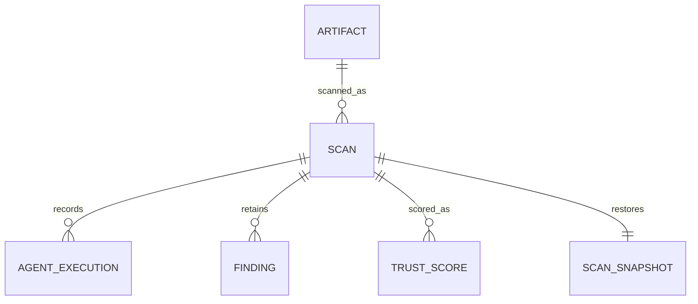
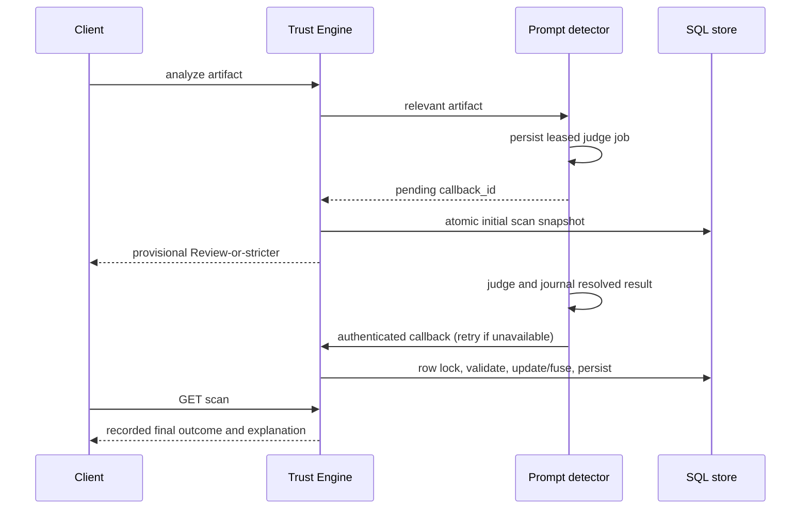

# System design

See FINAL_PROJECT_DOCUMENTATION.md for the service/routing diagram and numerical policy. Source responsibilities: `contracts/` owns detector schemas/capabilities; `runtime/` owns generated operational/readiness/cache/redaction helpers; detector `app/` packages own extraction/tools/rules; Trust Engine routing/orchestration/fusion own integration, and scan_store/lifecycle own SQL/updates. `app/ml` owns versioned vectorization, native JSON prediction and explanation metadata; policy never moves into that package.

## Storage relationships

SQL snapshots are the operational reconstruction authority; normalized rows support audit. Snapshots retain request identity, inputs/routing/results, pending timestamps, per-file outcomes and model metadata. Historical retrieval does not re-run a newer model. Prompt delivery has a separate bounded journal with leased job/result phases and retry due times; no callback token is persisted there. Redis TTL caches are expendable.

## Async sequence

Overdue completion is owned by Trust Engine and cannot be undone by late clean delivery. A batch can have several callbacks; no intermediate callback observation is assumed final. POST and tool process bounds limit work; timeout process groups are terminated. Model metadata validates schema/checksum, inference is CPU bounded, and model failure exposes weighted fallback. Return redaction preserves field structure while masking credential-shaped values; this is hygiene, not a claim that every secret format can be detected.
