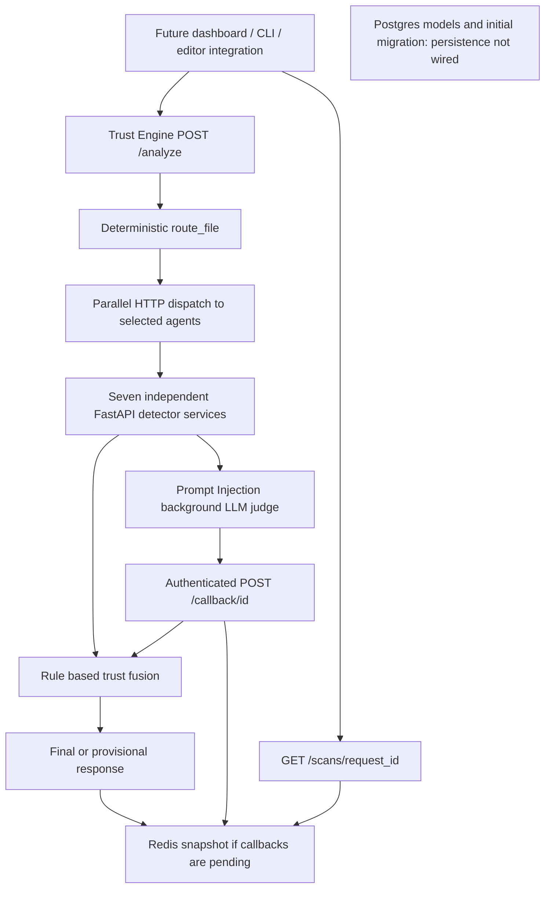

# PTIC / AI Supply Chain Guardian: implementation audit

Audit date: 11 October 2026. Scope: the current local checkout. This is an assessment and implementation backlog; application behavior was not changed.

## 1. Verdict

All seven detector services contain real detection logic. The project is substantially beyond the scaffold described by the root README. However, **implemented detectors do not yet form a dependable finished product**. The largest problems are capability/routing mismatches, inconsistent result semantics, scoring that can both accept unknown outcomes and reject clean dependency lists, missing scan persistence, and an unimplemented user interface.

Keep the microservice structure and the deterministic router/orchestrator/fusion separation. Repair the integration contract before investing in predictive models or a polished dashboard. Rewriting all agents would discard useful work without addressing the main failures.

| Component | Actual implementation | Assessment |
|---|---|---|
| CipherGuard | Python/npm manifest parsing, registry existence, popular-package edit distance, metadata heuristics | Useful detector; cache, extraction, scoring, and output preservation need correction |
| Code Security | Semgrep subprocess with 37 bundled rules for Python, JS/TS, PHP, Java | Useful static analysis; routing and language coverage disagree; JS/TS severity policy needs reconsideration |
| Secret Detection | Vendor signatures, credential context, entropy, suppression, masking | Working deterministic foundation; broad suppression creates confirmed misses |
| Docker Security | Dockerfile/Compose parsing, custom rules, Hadolint, Trivy, registry checks, hardening | Broad implementation; highest reliability risk because tools fail silently and fixes are not build-verified |
| Workflow/CI-CD | Three GitHub Actions rule families with reusable-workflow support | Clear scoped implementation; unsupported/malformed workflows and scanner errors are mishandled by integration |
| License Compliance | Registry license lookup, ScanCode text fallback, configurable policy, cache, limited transitive checks | Well separated stages; unknown outcomes and incomplete license expressions are not safe end to end |
| Trust Engine | LangGraph routing, parallel HTTP calls, deterministic fusion, authenticated asynchronous callbacks, Redis snapshots | Real orchestration; central contract and verdict bugs remain; predictive scoring and Postgres writes absent |
| Frontend | React/Vite/Tailwind startup and a single heading | Scaffold only |

## 2. Evidence and verification limits

- Inventoried all **205 tracked files**, totaling approximately 2.1 MB; parsed all 127 Python files successfully. This is syntax verification, not proof of correct behavior.
- Inspected detector pipelines, active API handlers, routing, dispatch, fusion, callback storage, schemas, database models/migration wiring, configuration, deployment, tests, fixtures, and evaluation tooling. The companion file inventory covers every tracked file. Large package snapshots were checked as datasets, not reviewed as thousands of individual package assertions.
- Did not print or include the local `.env` secrets. `.env.example` was reviewed. Git internals, generated caches, and permission-managed directories are outside application review scope.
- Local tests completed: CipherGuard **5 passed**; License Compliance **13 passed**; Prompt Injection **32 passed**; Trust Engine router/fusion/state **106 passed**; Docker parser/rules/scoring/normalizer/hardener subset **8 passed**; Secret Detection detector/status/fixture subset **15 passed**. Total of these completed groups: **179 passing cases**.
- Full Trust Engine collection is blocked by missing `fakeredis`. Full Code Security, Docker Security, Secret Detection, and Workflow suites did not finish within the 120-second audit bound. Some use synchronous FastAPI TestClient; the cause of the hangs was not established. These are **unverified suites**, not reported as passing or as proven production defects. Semgrep is also absent from the current PATH.
- Docker socket access failed, including the escalated inspection attempt. No running-stack, container-build, actual Semgrep/Hadolint/Trivy execution, live Redis/Postgres, live model, or live registry performance claim is made here.
- Findings labeled “reproduced” below were checked with local functions/models and synthetic inputs. Some fusion probes construct valid internal state directly; they demonstrate fusion behavior without claiming a full live HTTP scan.
- Historical numbers in READMEs, CODE_COMPARISON.md, and evaluation output are existing project claims, not measurements independently reproduced during this audit.

## 3. Actual architecture and REST API

The graph is `route -> call_agents -> fuse -> END`. The graph is a sequential orchestration skeleton; actual parallelism comes from `asyncio.gather` in dispatch. This is a reasonable use of LangGraph, but there are no autonomous agent-to-agent reasoning loops or predictive model in this graph.

### Public Trust Engine routes

| Route | Current behavior | Missing or problematic behavior |
|---|---|---|
| `GET /health` | Returns static OK | Does not establish detector, database, cache, or model readiness |
| `POST /analyze` | Validates a single artifact, routes, calls detectors, returns trust result and request ID | No multi-file/repository API, persisted history, public authentication, rate limit, or transport-level body bound |
| `POST /callback/{callback_id}` | Shared-token auth before body parsing/Redis lookup; validates result identity; resolves pending record and re-fuses | No atomic read-modify-write; no durable task delivery; overdue scans are not finalized as timeout/error |
| `GET /scans/{request_id}` | Reads snapshots for scans that initially went pending | A scan initially final is not stored and returns 404 here; pending snapshots expire after default 1 hour |

Every detector exposes `/health` and `/analyze`. Docker's richer request options exist only at the detector boundary. The public `ArtifactRequest` declares `content`, `type`, `filename`, `ai_tool_source`; extra input fields are dropped by Pydantic. Consequently callers cannot use the public API to request Docker CVE scanning or control hardening through `options`. Likewise explicit `language`/`ecosystem` hints do not survive this public model.

Compose publishes only the Trust Engine among detector/engine services, plus Postgres on port 5432. All detectors are on one internal network. Redis has no host publication. All service containers receive the entire root `.env`, unnecessarily distributing database/API/callback credentials to services that do not use them.

### Router's current dispatch table

| Resolved type | Agents selected |
|---|---|
| code | Code Security, Secret Detection, Prompt Injection |
| dockerfile | Docker Security, Secret Detection |
| workflow | Workflow/CI-CD, Secret Detection |
| dependency | CipherGuard, License Compliance, Secret Detection |
| unknown | Secret Detection only; partial coverage |
| lockfile, binary, >1,000,000 bytes | None; no coverage |

Explicit `type` wins over filename; conflicts are noted but do not reduce coverage. Without a filename, the router sniffs Docker `FROM`, GitHub workflow structure, and dependency JSON. With an unrecognized filename it does not sniff content. “Full” currently means a recognized routing type, not that every applicable scanner actually analyzed the artifact.

## 4. Priority findings

### P0: fix verdict and coverage correctness first

**F01 — Expected `stub` responses can yield Accept / 100. Reproduced.**

Sources: `trust_engine/app/fusion.py`, `routing.py`; `workflow_cicd/app/main.py`; `code_security/app/main.py`; `license_compliance/app/main.py`.

Fusion gates on `error` and `pending`, but ignores expected `stub` results. The router reports `.gitlab-ci.yml` as full workflow coverage while the workflow agent only understands GitHub Actions and returns stub. The same issue exists for JSX/TSX/MJS/CJS sent to Code Security, which refuses those suffixes. A malformed named GitHub workflow also returns stub. With other agents clean, an artifact lacking its intended specialist check can be accepted.

Fix: define capabilities explicitly, calculate achieved coverage after dispatch, and hold expected-but-unsupported calls at Review. Distinguish “irrelevant detector not selected” from “selected detector could not analyze.”

**F02 — Unknown license findings can produce Accept / 100. Reproduced.**

Sources: `license_compliance/app/license_lookup.py`, `conflict_engine.py`; `trust_engine/app/fusion.py`.

Failed license identification creates `needs_review` with confidence 0 and a medium `license_review` finding. Central risk is severity weight multiplied by confidence, so this adds zero penalty and does not trigger the high/critical floor. Even a medium review at confidence 0.85 often leaves the score in Accept. The detector's explicit request for human review is lost.

Fix: carry uncertainty/policy decisions separately from probabilistic finding penalties. An unresolved required license check must hold Review regardless of confidence.

**F03 — Clean dependencies accumulate risk and eventually get rejected. Reproduced.**

Sources: `cipherguard/app/main.py` and `trust_engine/app/fusion.py`.

CipherGuard emits a low-severity finding for every dependency, including `score=0` packages labeled Clean Pass, with confidence 0.8. Fusion penalizes each by `3 * 0.8 = 2.4`. Synthetic all-clean results show 9 packages => **78.4 / Review**; 21 => **49.6 / Reject**. The score measures dependency count instead of actual risk.

Fix: move clean per-package observations into evidence; emit findings only for risks. Define a calibrated aggregation policy and avoid duplicate-count inflation.

**F04 — Docker tool failures silently look like zero findings. Reproduced for missing binaries.**

Sources: `docker_security/app/engines/hadolint.py`, `trivy_config.py`, `registry/image_check.py`, `app/main.py`.

Hadolint and Trivy config catch all errors and return `[]`. Missing binaries, timeouts, invalid output, and crashes are indistinguishable from clean tool execution. Registry network errors default to `exists=True` and cache that answer for 24 hours. Health declares both tools available unconditionally; evidence lists engines executed even when Trivy image scanning was disabled.

Fix: return structured engine results with completion status, error reason, duration, and findings; expose degraded coverage and never cache failed verification as existence. Readiness must check configured mandatory engines.

**F05 — Detector Finding information is silently stripped at the Trust Engine boundary. Confirmed by schema inspection.**

Sources: `trust_engine/app/schemas.py`; CipherGuard/Docker `app/schema.py`; Secret Detection `app/schemas.py`.

The Trust Engine accepts only `category`, `severity`, `confidence`, `location`, `details`, `score`. CipherGuard sends package, ecosystem, line, reason, remediation, signals as other top-level fields; Docker sends reason, remediation, sources, line and `hard_block` similarly. These parse successfully but are discarded. CipherGuard override can still see the numeric score, but often cannot name the package; Docker hard-block semantics and detailed locations are lost. Secret Detection preserves reason/remediation in `details`, but its masked preview and flat line/path fields are dropped.

Fix: put portable fields in the common contract and domain extensions in `details`; test the entire serialized round trip, not just response top-level keys. Maintain a versioned contract artifact without forcing in-process imports across microservices.

**F06 — Central fusion does not preserve Docker hard blocks. Reproduced at fusion boundary.**

Source: `trust_engine/app/fusion.py`.

A single critical Docker container-escape result becomes score 60 / Review; only CipherGuard, Secret Detection, Prompt Injection and Code Security have hard overrides. Docker's `hard_block=True` is also stripped by F05. A detector's explicit hard-block result should not become a discretionary review if blocking is the intended project policy.

Fix: add an explicit, validated decision-floor/policy-rule contract and central policy for Docker escape/invalid-image blocks. Decide and document how workflow critical findings and license denylist violations should affect the overall result.

### P1: integration and scanner behavior

**F07 — Real capabilities are unreachable or incompletely routed. Reproduced.**

- `docker-compose.yml` / `compose.yaml` => unknown => only Secret Detection; Docker's Compose analyzer is never selected automatically. Explicit `type=compose` is invalid at the public entrypoint.
- `README.md` => unknown => only Secret Detection; the implemented markdown Prompt Injection extractor is bypassed.
- `.java` / `.php` => unknown => only Secret Detection, despite actual Semgrep rules for these languages.
- `.go` => full code route, but no Go rules exist in the bundled Semgrep ruleset.
- `.jsx`, `.tsx`, `.mjs`, `.cjs` => full code route, but Code Security returns stub for their suffixes.
- `pyproject.toml`, Pipfile and lockfiles have no complete parser/routing support; some license guard filenames imply support that extraction does not provide.

Fix: one capability matrix must drive router decisions, API validation, detector guards, documentation and test cases. Unsupported ecosystems should report partial coverage explicitly.

**F08 — Routing inference is not normalized into the forwarded payload. Reproduced extractor/guard mismatches.**

Sources: `trust_engine/app/orchestration.py`; CipherGuard extraction; License Compliance guard/extraction.

Dispatch forwards the original file dictionary rather than adding its resolved artifact type. `requirements-dev.txt` is routed to License Compliance but its guard returns stub unless `type=dependency` is supplied. Filename-less package JSON is recognized by the router, yet CipherGuard treats `unknown` as Python requirements; License Compliance's guard may return stub because `type` was inferred rather than supplied. Filename-less JSON containing only devDependencies also misses the license ecosystem sniffer even when dependency type is explicit.

Fix: construct a canonical request after routing with resolved type, format/ecosystem and original filename; make each parser consume that contract.

**F09 — Malformed/skipped dependency manifests can be clean passes. Reproduced parsing behavior.**

Sources: both manifest extractors, `license_compliance/app/main.py`.

Malformed package JSON yields an empty dependency list in both agents. License Compliance returns pass for zero extracted dependencies; a manifest consisting only of unsupported entries also returns pass with skipped information in evidence. CipherGuard silently skips several URL/include formats. These outcomes need to be distinguished from a valid, genuinely empty manifest.

Fix: return parse status, recognized format, extracted count, skipped entries and coverage; syntax failure must be error, unresolved includes/workspaces should reduce coverage.

**F10 — Secret suppression drops real credential patterns. Reproduced.**

Sources: `secret_detection/app/detectors/suppression.py`, `structural_context.py`.

Any value containing `test`, `sample`, `example`, etc. is suppressed, including vendor-signature matches. A structurally detected strong password containing `test` disappears; the same password without it is flagged. Stripe `sk_test_...` matches are particularly vulnerable to this blanket filter. Every credential shorter than eight characters is suppressed, including context-confirmed passwords. Generic unquoted YAML/env assignments are not captured by the quoted-value regex.

Fix: exact/context-aware placeholder patterns; vendor-specific handling of test/private/public keys; preserve short context-confirmed passwords; add format-aware assignments and regression cases. Keep masking and avoid live credential verification by default.

**F11 — Docker hardener verification is not build verification. Reproduced output.**

Source: `docker_security/app/harden/dockerfile_hardener.py`.

For Alpine it injects `groupadd/useradd` rather than Alpine-specific commands, and a curl-based `/health` check without ensuring curl or that endpoint exist. Scratch/distroless images cannot run these shell-based steps. It inserts the user block before the first CMD/ENTRYPOINT across the whole file instead of anchoring insertion to the final stage. It can change an unknown image tag to mutable `stable` without establishing that tag exists. It treats any earlier non-root USER as sufficient even if a later USER returns to root. `original_findings_count=0` produces `verification_passed=True` even when the re-scan reports remaining findings.

Fix: offer explicit patches with preconditions; target the final stage and final USER; avoid inventing tags/endpoints; verify available tools and syntax; test actual builds for supported base families. Until then label output as suggested changes, not verified hardening.

**F12 — Image reference parsing/checking breaks valid Docker forms. Reproduced parsing.**

Sources: `docker_security/app/parsing/dockerfile_parser.py`, `registry/image_check.py`, `app/main.py`.

`FROM alpine@sha256:abc` splits to image `alpine@sha256` and tag `abc`; `FROM localhost:5000/team/image:1` splits at the registry port. A prior stage alias in `FROM builder` is treated as a public image and checked against Docker Hub. All registry existence lookups go to Docker Hub, even for ghcr.io and other allowed registries. Private-image authentication is absent. Variables are skipped without explicit uncertainty.

Fix: parse registry/name/tag/digest separately, resolve prior-stage aliases, implement appropriate registry APIs/auth, and mark unsupported references as unverified instead of absent/clean.

**F13 — LLM judge output is permissively coerced into a verdict. Reproduced.**

Source: `prompt_injection/app/judge.py`.

`{}` is accepted as a successful “not injection” result at confidence 0.5. A string `"false"` becomes Python truthy and is treated as injection. Missing fields and non-finite values are not strictly validated. Voting ties choose “not injection”; failed votes reduce the effective electorate without a minimum quorum.

Fix: a strict typed verdict with required boolean/confidence/justification; finite bounded confidence; inconclusive results and ties should remain unresolved/Review. Add adversarial tests aimed at confusing the classifier itself.

**F14 — Dependency timeout budgets do not fit orchestration's 10-second cap. Confirmed by code.**

CipherGuard allows three 10-second registry attempts plus retry delays (~33 seconds worst case before queueing/processing). License Compliance can do an 8-second direct lookup round followed by another transitive round and synchronous ScanCode processing. Docker can do multiple 3-second stage registry checks, then hardening/re-linting; optional image scans add more. Trust Engine times out all detectors at 10 seconds. The per-request semaphore does not bound concurrent calls across separate incoming requests.

Fix: end-to-end deadline budgeting, bounded global workers, per-detector configuration, and asynchronous jobs for expensive paths. Record cancellation and timeouts distinctly.

**F15 — Cache implementations diverge from configuration and documentation. Confirmed by code.**

CipherGuard starts with `use_memory_fallback=True` and never enables Redis; its dictionary has no TTL or eviction, and failed registry answers are cached. Docker uses `REDIS_HOST`/`REDIS_PORT` while Compose's shared setting is `REDIS_URL`, so it normally tries container localhost. Docker memory-cache reads use the default TTL rather than the TTL supplied to each write. License cache connections/operations lack explicit short socket deadlines, and unpinned versions use the normal multi-day cache TTL.

Fix: use a consistent Redis URL and bounded operations, healthy-result caching rules, memory TTL/size limits, and shorter unpinned/negative-entry TTLs.

**F16 — Code Security downweights actual JS/TS vulnerabilities below the severity floor. Confirmed by code.**

Source: `code_security/app/scanner.py`.

Every bundled rule is ERROR => high, but JS/TS are downgraded to medium. A single SQL/command injection at confidence 0.85 then costs only 8.5 centrally and can yield 91.5 / Accept. A language's population vulnerability frequency does not by itself establish that a particular matched injection has lower impact. No current bundled rule maps to critical, so the central Code Security critical override is unreachable with current output.

Fix: preserve impact severity by rule; if using calibrated language priors, apply them to confidence/scoring separately and validate against a held-out dataset.

**F17 — Workflow scanner crashes report `fail` with no findings; fusion accepts that shape. Reproduced fusion shape.**

Sources: `workflow_cicd/app/main.py`, `trust_engine/app/fusion.py`.

The crash handler returns fail plus evidence.error and zero findings. Central fusion does not gate fail status, so such a record can yield Accept / 100. Invalid named workflow YAML returns stub. Broad permission checking only runs for its selected dangerous triggers; it does not comprehensively analyze effective inherited permissions or attacker-controlled expression execution.

Fix: scanner crashes => error; malformed expected workflows => error; reject inconsistent fail-with-no-findings responses or hold Review. Expand rule coverage deliberately rather than advertising comprehensive CI security.

**F18 — Partial license expressions lose obligations. Reproduced normalization.**

Source: `license_compliance/app/license_lookup.py`.

`MIT AND Proprietary` normalizes to `['MIT']`, drops the AND operator, and merely records an unmatched-text warning. That is capable of producing compliant despite an unresolved required branch. Nested SPDX expressions and WITH exceptions are not properly parsed. ScanCode fallback splits AND/OR and assigns OR whenever it sees multiple IDs, losing the original logical expression.

Fix: use a complete expression tree; preserve unknown branches and operators; never turn a partially parsed AND into a single permissive license. Treat registry declaration confidence separately from audited package-source evidence.

### P1/P2: API, state and operational completion

**F19 — Public and result schemas need stricter invariants.** Confidence and score are unbounded at the Trust Engine; a negative finding confidence is accepted and subtracts negative risk, raising the score. Pending without callback_id can be accepted as a result but never stored/resumed; API scan_status is based on callback entries rather than pending records. `_post_detector` does not validate that response.agent_name matches the agent called. Missing expected results, dropped files and dispatch mismatches are not independently gated by fusion. The 50-file truncation note does not itself force Review; this becomes relevant when multi-file API support is added.

**F20 — Asynchronous judgment is not durable.** Prompt Injection background tasks live only in process memory. Service restart loses work; callback delivery has bounded retries then gives up; a Trust Engine Redis write failure returns a provisional result that cannot resolve. No worker queue, dead-letter handling, retryable scan lifecycle, or overdue callback finalization exists. Read-modify-write callbacks become a lost-update risk once multi-file/multiple-pending work is exposed. Callback authentication and duplicate-delivery acknowledgement are good existing safeguards.

**F21 — Scan history is absent despite real database tables.** `db/models.py` defines Artifact, Scan, Agent, Finding, DependencyDetail, SecretDetail, DockerDetail and TrustScore. An initial Alembic migration exists. `/analyze` and callbacks never use the DB session. No agent seeds, insert/update transaction layer, final result retention, history list, artifact retrieval or report export exist. DB score column is Integer while fusion emits decimals; reconsider precision before integrating.

**F22 — Migration/deployment path is incomplete.** Alembic's offline branch incorrectly calls `run_migrations_online()`, so `--sql` will not provide the intended offline path. `alembic/env.py` imports dotenv without a direct trust_engine requirement and searches a service-local `.env` rather than root, so root environment loading must be documented/configured. Compose does not execute migrations, wait on readiness healthchecks, or initialize agent rows. `depends_on` supplies start order only in the current configuration.

**F23 — Configuration is often descriptive rather than executable.** CipherGuard, Secret Detection, Docker, Workflow and Trust Engine config settings are largely not loaded by their runtime implementations. CipherGuard mentions OSV/crates.io but implements neither. Secret config says Gitleaks/TruffleHog, but uses its own detectors. Trust config claims SHAP/narration/agent weights, but fusion ignores those switches and weights. `.env.example` threshold 70 is unused; actual Accept threshold is 80. Prompt semantic model/anchor configuration is hardcoded in embeddings, and some enabled switches are not honored. License policy is actually loaded and is the strongest configuration example here.

**F24 — Health and deployment do not establish usable scanning.** Static OK checks do not surface model fallback, missing tools or unavailable registries. Docker CVE scanning defaults off; `--skip-db-update` needs a pre-existing vulnerability database, but no DB preparation is supplied in its image. Prompt embedding weights are not bundled into its Docker build, and missing weights fall back to bag-of-words without advertising that degraded backend in results. Most service containers run as root; only Docker Security explicitly sets a non-root user. No CPU/memory/service concurrency limits, persistent Trivy cache or granular network/secret settings are configured.

**F25 — Browser and client integration are unbuilt.** No form/upload, score view, evidence cards, pending polling, history, export, CLI, pre-commit hook or VS Code extension exists. The Vite server has no API proxy and the backend no configured CORS middleware. Choose a same-origin proxy or explicit allowed origins when wiring the UI. There is no authentication/project/user model for a shared deployment; add that when moving beyond a local single-user demo.

**F26 — Reproducibility/evaluation need work.** Most Python dependencies are lower-bounded rather than locked; frontend has no tracked lockfile; no CI workflow is tracked. Existing schema audit validates top-level fields and basic shape, but does not detect all discarded finding fields and omits callback_id in its allowed top-level set. Prompt baseline treats pending/error as unflagged rather than awaiting resolution/recording inconclusive, and compares only six hand-written cases against partial baseline components. Latency tooling does not measure async time-to-final and has inconsistent per-agent timing extraction (license reports seconds). Its percentile index uses rounding rather than the stated nearest-rank ceiling, so some sample sizes produce the wrong percentile. Existing comparisons require pinned versions, full provenance, realistic clean data and held-out attack data before accuracy claims are defendable.

## 5. How each agent was built, and what to retain

### CipherGuard

`main.py` accepts inline content, extracts Python or npm dependency tuples, runs concurrent registry requests, combines existence, edit-distance and metadata signals, and emits per-package scored Findings. HTTP clients cap connections at 500; registry-specific semaphores cap active requests at 80 each. Top-package JSON snapshots contain 10,000 npm names and a PyPI rows dataset; distance calculations are LRU-cached and bucketed by name length. Registry 404 and failed requests map to risk 100; suspicious heuristics add penalties and are capped below the hard-block tier. Downloads remain -1, so low-download scoring does not fire with the current fetchers. Package versions are shown but existence checks are package-level, not release-level. The HTTP endpoint correctly refuses absent/non-string content rather than opening a caller-supplied filename.

Retain extraction/registry/detection/scoring boundaries, inline-content protection and bounded registry concurrency. Fix F03/F05/F08/F09/F14/F15; distinguish unavailable registry from nonexistent package so an outage is not presented as proven hallucination. Current fusion rejects a CipherGuard error finding at score 100 via its existence override. Move clean observations out of Findings and add version-existence/OSV only if included in the accepted project scope.

### Code Security

`main.py` has a Semgrep warm-up, guards content/suffix, and catches scanner exceptions as error. `scanner.py` writes source to a temporary file, executes a local pinned Semgrep CLI with an 8-second timeout, parses JSON errors/findings, adds rule/CWE/remediation and cleans up. The rules include SQL injection, TLS bypass, shell execution, eval, XSS, deserialization, SSRF, password comparison and hashing patterns. Python has 10 rules, JS/TS 9, PHP 9, Java 9; Go has none. Tests include clean/vulnerable fixtures for four languages, but need a working binary. Bandit, CodeQL and a separate tree-sitter integration are absent.

Retain subprocess isolation, bundled offline rules, remediation and explicit scanner-error handling. Fix F01/F07/F16, check actual scanned targets and return codes, and decide how to report partial parsing coverage. Warm-up completion currently does not guarantee a successful scanner run because the underlying helper may time out and the app continues.

### Secret Detection

The active handler normalizes one artifact or a legacy files list. `SecretScorer` combines vendor and structural candidates, deduplicates by line/value, computes entropy, applies suppression, derives severity/confidence and emits masked previews. Vendor signatures cover 13 families; structural checks include connection-string passwords and quoted credential assignments. High/critical findings map to fail; non-severe findings to warn. This scanner does not call Gitleaks or TruffleHog despite its config text. Entropy is a boost for selected structural candidates, not a full standalone search across all random strings. Candidate deduplication is exact line/value rather than complete overlapping-span elimination.

Retain deterministic layers, masking, status derivation and context-rich details. Fix F10 and validate nested file payload types; `{content: null}` currently normalizes to empty readable content rather than error. Move blocking CPU work off the async event loop or bound work. Add format-specific secret coverage and a larger false-positive corpus.

### Docker Security

The handler auto-detects Compose from content, otherwise parses Dockerfile stages. It runs custom rules, Hadolint, Trivy config and Docker Hub existence checks concurrently in threads. Optional image CVE scans are sequential and call blocking subprocesses; default hardening runs afterward. Custom Dockerfile rules check privilege, tag pinning, embedded secrets, remote shell execution, TLS bypass, sensitive ports, file permissions, unwanted tools, COPY credential files, health checks and registry allowlists. Compose rules check privilege, socket/host mounts, namespaces, capabilities, profiles, limits, exposed DB ports, secrets and root execution. Normalization merges known concepts by line and selects maximum severity; scoring respects its local hard-block flag.

Retain rule/parser/engine separation, concept normalization and explicit image-CVE unavailable findings. Fix F04/F05/F06/F11/F12/F14/F15 first. Compose long-form volumes and ports are currently converted to strings rather than parsed structurally; host/path/port checks can miss them. Resource-limit checking has an `elif` that misses service-level limits when a non-empty deploy block exists without deploy limits. Non-root defaults cannot be established solely from absence of Compose `user`, since the image may declare USER. These need realistic fixtures.

### Workflow/CI-CD

`scanner.py` uses safe YAML loading and normalizes the YAML 1.1 `on`/True issue. It checks full SHA action pinning, dangerous-trigger/broad-permission combinations, and remote download pipes to shells/PowerShell. Reusable workflows and job-level permissions are included; positions use a text occurrence finder rather than YAML source marks. A 0–100 value named workflow_risk_score actually goes **up when cleaner**; Docker/CipherGuard risk scores go up when riskier, so this name/direction must be standardized.

Retain scoped deterministic rules, reusable-workflow support and YAML key normalization. Fix F01/F07/F17 and effective permission inheritance. GitLab support and OPA integration are genuinely absent. Return clear unsupported coverage until implemented.

### License Compliance

Extraction yields dependency records plus skipped entries. Startup creates a shared HTTP client and Redis cache; registry metadata is preferred over scanning. PyPI license_expression/classifiers/free text and npm declared license fields are normalized. ScanCode's real Python API scans only the available license metadata text, not package source archives. Policy modes include no-copyleft, permissive-only and custom; simple AND/OR reasoning emits compliant/conflict/needs_review. One level of transitive names is checked, capped at 10; exact installed transitive versions are not resolved. Only conflicts/reviews become Findings, while all verdicts remain in evidence.

Retain staged design, real configurable policy, cache-independent correctness and explicit skipped-entry evidence. Fix F02/F08/F09/F14/F18. Npm caret/tilde ranges are stripped to a version and treated as if exact; this does not establish the installed version. Python unpinned versions query current metadata; there is no implemented gate specifically marking those uncertain despite comments suggesting one. Peer/optional npm dependencies are not analyzed here, unlike CipherGuard. Full lockfile graph/SBOM and package-source license auditing remain future scope.

### Trust Engine

Router is deterministic; dispatch records selected `(file, agent)` calls, durations/errors and pending IDs; LangGraph appends results through an operator.add reducer and nodes return partial updates to avoid duplicates. URLs come from environment. Fusion uses `100 - sum(severity_weight * confidence)`, floors score at 0, applies selected hard overrides, and holds error/pending/partial coverage at Review. Actual boundaries are 80 Accept, 50 Review, otherwise Reject. High/critical presence also floors Review. Redis snapshot serialization preserves typed routing/results; callbacks authenticate with a timing-safe token comparison, validate IDs/agent names, acknowledge duplicates and re-run fusion.

Retain this structure, status separation, provisional floors and callback authentication. Correct F01–F06/F19–F22 before extending multi-file operation. The project name “Predictive AI Trust Engine” describes the planned layer: no trained model, XGBoost, SHAP or LLM narration is wired. Negative breakdown values are rule penalties, not SHAP attributions. The unused Trust Engine LLM client still has unimplemented Ollama support; Prompt Injection's copy has real Ollama and OpenAI paths.

## 6. What remains, in the fastest useful order

### Milestone A — dependable scanner API

1. Define a versioned ArtifactRequest/AgentResult/Finding contract with format/capability/coverage, bounded confidence, explicit uncertainty and policy floors, timing, and preserved details.
2. Align routing with that capability matrix; support Compose/markdown/PHP/Java correctly and report unsupported Go/GitLab/manifest forms honestly.
3. Repair fusion: clean packages contribute zero; required stub/error/unknown license checks hold Review; true hard blocks survive; invalid/missing records cannot imply full coverage.
4. Repair Docker engine failure handling and parser behavior; make hardening opt-in suggestions until verification is trustworthy.
5. Add meaningful integration regressions for every confirmed failure above, including actual detector serialization through Trust Engine parsing and public requests with inferred types.

**Completion evidence:** clean dependency lists of different sizes stay clean; unsupported/failed required scans cannot Accept; Docker hard blocks retain their decision; malformed input never becomes a verified clean result; scanner details survive the API.

### Milestone B — persistent scan lifecycle

1. Repair and validate migration execution, align score precision and seed agent identities.
2. Persist every scan, agent outcome, finding, routing decision and final/provisional score transactionally.
3. Make GET /scans work for all scan IDs; add paginated scan history and report retrieval.
4. Add durable background work and callback retries, atomic updates, overdue failure transitions, retention and safe raw-artifact handling.
5. Add structured request IDs, agent durations and readiness/degraded status.

**Completion evidence:** service restarts do not erase accepted work/history; provisional scans become final success or explicit timed-out/error outcomes; duplicate/concurrent callbacks preserve all records.

### Milestone C — usable project/demo workflow

1. Build the dashboard: paste/upload artifact, filename/type hints, request submission, score/decision, coverage and evidence/remediation, async polling and history.
2. Configure browser/API connectivity through a same-origin proxy or scoped CORS.
3. Add a minimal CLI and pre-commit workflow using the same public API, then the editor integration if required for evaluation.
4. Add multi-file request support with explicit per-file outcomes, enforced total body/work bounds and complete coverage accounting.

**Completion evidence:** a user can submit a real project sample, see why it was accepted/reviewed/rejected, revisit the report and block a commit through an actual integration.

### Milestone D — evaluation and research claims

1. Lock tool/runtime versions and add CI with reproducible per-service and combined integration tests.
2. Build representative labeled clean/risky artifact data per agent, including attacks not written by the implementation author.
3. Measure accuracy, false positives/negatives, unresolved cases, cold/warm p50/p95 and concurrent load; measure initial-response and time-to-final separately.
4. Calibrate rule weights/thresholds. Introduce XGBoost and SHAP only with adequate independent training/validation/test data and a reproducible model pipeline.
5. Add narration only as an explanation of verified results. Keep deterministic policy gates authoritative.
6. Correct README/config/evaluation descriptions to match the product actually delivered.

**Completion evidence:** reported results can be regenerated from pinned code, data and tools; uncertainty is counted rather than hidden; predictive-model claims correspond to an implemented trained model.

No calendar estimate is asserted because accepted PTIC requirements, team availability, deployment target and required research deliverables are not present in the checkout. Referenced project documents in comments are not all available here; the backlog separates current bugs from optional future features rather than inventing missing acceptance criteria.

## 7. File coverage and follow-up

See `FILE_INVENTORY.md` for all 205 tracked files with line counts, code entrypoints and roles, and `reproductions.txt` for captured local probes. The implementation findings above are organized by behavior because cross-service failures span several files. This audit does not claim to prove every rule, external package, dataset entry or deployment path correct.

The next implementation batch should be Milestone A: contract, routing and fusion correctness, followed by Docker reliability. That gives a trustworthy foundation for persistence and a dashboard without rebuilding the seven services from scratch.
